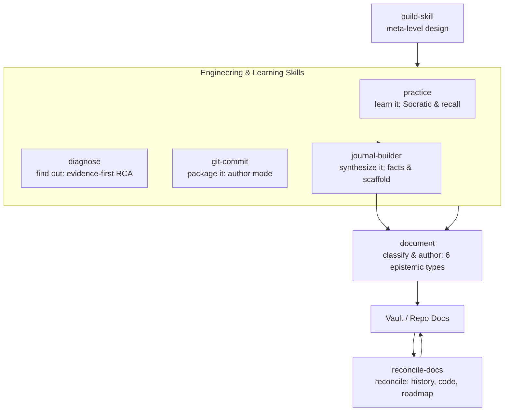

# Skills

**Modular, harness-agnostic skills for disciplined pair programming with coding agents.**

A collection of lightweight, single-purpose skills focused on low context overhead (≤80 lines), minimal ceremony, and user-approved state transitions. 

Designed to support critical systems thinking, active learning, disciplined engineering, and durable documentation across any compliant agent platform.

This collection was not designed for a Senior Software Engineer, but for learners, with the primary goal of maximizing long-term learning gains; the idea is to learn to think like a software engineer and architect, rather than simply producing code.

---

## Why Build Instead of Borrow?

There are many great Skills bundles out there, written by and for experienced developers to orchestrate automated "software factories". Many existing agent workflows optimize for experienced developers who want to delegate as much implementation work as possible. 

That is a reasonable goal, but it is not mine. As a learner, I need the workflow to preserve opportunities to reason, make decisions, debug, and build mental models.

Copying skills crafted for someone else's workflow imports their cognitive shortcuts, and assumptions. I believe that AI is useful for much more than only producing code. 

These skills exist to enforce four core principles:

1. **Defeating the Comprehension Illusion**: Having an AI generate code is not the same as understanding how a system behaves. When code velocity outpaces comprehension, you end up with systems you cannot debug when production breaks. Skills like `practice` make the learner write the code and drive analysis, ensuring mental models develop alongside the codebase.

2. **Intentional Epistemic Friction ("Your call")**: Great engineering requires deliberate checkpoints. Instead of letting agents make unilateral architectural choices, these skills pause at critical state transitions—requiring proven root causes before patching (`diagnose`), approving reviewable atomic slices (`git-commit`), or identifying learning opportunities that should be preserved as durable knowledge (`document`).

3. **Operational Ownership**: An agent should investigate, measure, and propose concrete options, but the human engineer must own the trade-offs, failure domains, and repository history. You cannot own what you did not decide.

4. **Radical Simplicity over Prompt Bloat**: Many third-party skills are brittle, multi-page prompts that consume context and hallucinate complex state machines. These skills adhere to strict line caps (≤80 lines for portable skills), the deletion test, and minimal ceremony.

---

## The System Architecture

The system is under active testing and continuous improvement. Currently, the skills form an orchestrated pair-programming workflow. `build-skill` governs meta-level skill design. 

Three core operational skills (`practice`, `diagnose`, `git-commit`) structure day-to-day engineering. `document` evaluates whether insights produced during work warrant durable preservation.



Every skill features an explicit **"Your call"** checkpoint where the agent pauses and asks the human to make critical architectural, diagnostic, and commit decisions with 2-3 concrete options.

---

## Active Skills

### Portable Core (`skills/`)

| Skill | Trigger / Command | Purpose | Length |
| :--- | :--- | :--- | :--- |
| **[`practice`](skills/practice/SKILL.md)** | `/practice [topic]`, `/practice review` | Socratic tutoring and delayed retrieval. Learner writes all code; uses graduated assistance, rubric calibration, and recall-before-reveal. | 50 lines |
| **[`diagnose`](skills/diagnose/SKILL.md)** | `/diagnose [symptom]` | Evidence-first troubleshooting. Progresses from raw logs to proven root cause and minimal, reversible fixes. | 49 lines |
| **[`git-commit`](skills/git-commit/SKILL.md)** | `/git-commit` | Working-tree inspection, atomic slice decomposition, and author-driven message authoring in learning sessions. User approves every commit. | 60 lines |
| **[`document`](skills/document/SKILL.md)** | `/document` | Second-order knowledge classifier (Discussion, ADR, Plan, Debug Record, Knowledge, Journal). User confirms type and provides core insight. | 53 lines |
| **[`journal-builder`](skills/journal-builder/SKILL.md)** | `/journal-builder` or `/journal` | Two-phase daily engineering review: generates factual skeleton with question blanks, then reviews and calibrates user reasoning. | 58 lines |
| **[`reconcile-docs`](skills/reconcile-docs/SKILL.md)** | `/reconcile-docs [path]` | Reconciles historical evidence, present code reality, and future plans into canonical repo docs (README, ARCHITECTURE, ADR, ROADMAP). | 37 lines |
| **[`build-skill`](skills/build-skill/SKILL.md)** | `/build-skill [topic]` | Interactive design, sizing, authoring, and empirical dogfooding of agent skills. Enforces design review gate before file creation. | 49 lines |
| **[`inspect-flake-update`](skills/inspect-flake-update/SKILL.md)** | `/inspect-flake-update` | Inspects updated flake.lock inputs, reviews upstream revisions, runs nix flake check, and drafts commit messages. | 46 lines |

### Vault Extensions (`extensions/`)

| Skill | Status | Purpose |
| :--- | :--- | :--- |
| **[`draft-curation`](extensions/draft-curation/SKILL.md)** | Active | Triages, classifies, and commits incoming notes from an inbox/staging directory into structured lifecycle directories. |
| **[`commit-logger`](extensions/commit-logger/SKILL.md)** | Active | Immutable Git commit event capture script into a machine-readable CSV ledger (consumed by `journal-builder`). |

---

## Skill Interaction Matrix

| From \ To | Practice | Diagnose | Git Commit | Journal Builder | Document | Reconcile Docs |
| :--- | :--- | :--- | :--- | :--- | :--- | :--- |
| **Practice** | — | yields for production incidents | learner types the commit | feeds learning edges | optional handoff on key insights | — |
| **Diagnose** | yields if user wants to find cause | — | hands off to package verified fix | feeds incident root causes | hands off if RCA reveals non-obvious lesson | — |
| **Git Commit** | learner-controlled | packages remediation result | — | records commit events to ledger | delegates if commit warrants deeper doc | provides commit history |
| **Journal Builder** | hands off unresolved gaps | hands off active defects | assesses ledger events | — | hands off candidate journal draft | — |
| **Document** | consumes practice milestones | consumes RCA findings | packages docs if committed | consumes completed journal drafts | — | provides ADRs and plans |
| **Reconcile Docs** | — | — | verifies commit reality | — | audits ADRs and plans | — |

---

## Canonical Flows

1. **Investigation to History**: `diagnose` (verify root cause) -> `git-commit` (atomic slice approval) -> `document` (optional Debug Record / ADR).
2. **Deliberate Practice to Knowledge**: `practice` (solve transfer challenge) -> `document` (author durable knowledge article).
3. **Retrospective Scaffolding to Journal**: `commit-logger` (event ledger) -> `journal-builder` (fact skeleton & question blanks) -> user fills reasoning -> curation & calibration -> `draft-curation`.
4. **Documentation Reconciliation**: `reconcile-docs` (audit history, code reality, roadmap) -> propose updates to README / ARCHITECTURE / ADRs -> user approves.
5. **Skill Design Loop**: `build-skill` (approve spec) -> dogfood run -> minimal mechanism refinement.

---

## Installation & Portability

The repository includes an idempotent install script (`install.sh`) supporting both symlink and copy modes:

```bash
# Default install to ~/.gemini/config/skills (symlink mode)
./install.sh

# Verify installation health and detect missing skills
./install.sh check

# Install to custom harness path in copy mode
./install.sh --mode copy --target ~/.custom-agent/skills
```

When run:
- Portable skills and active extensions are linked/copied to the target directory.
- Deprecated or superseded skills are safely relocated to a dated backup directory (`skills.backup-<date>`).
- The global profile `profile/AGENTS.md` is installed as the user's base agent instruction.

---

## Governing Design Rules

1. **One authoritative owner per rule.** If a rule belongs in `AGENTS.md`, do not restate it in every skill.
2. **The deletion test.** If deleting an instruction does not change agent behavior in a meaningful way, delete it.
3. **Plain words over jargon.** Prefer "decision" over "epistemic commitment", "steps" over "state machine".
4. **80 lines maximum for `SKILL.md`.** Deep templates and authoring specs live in `references/`.
5. **Human ownership of critical decisions.** The AI investigates, drafts, and proposes; the human approves the architecture, commits, and destinations.

---

## License

Released into the public domain under the [Unlicense](UNLICENSE.md).
