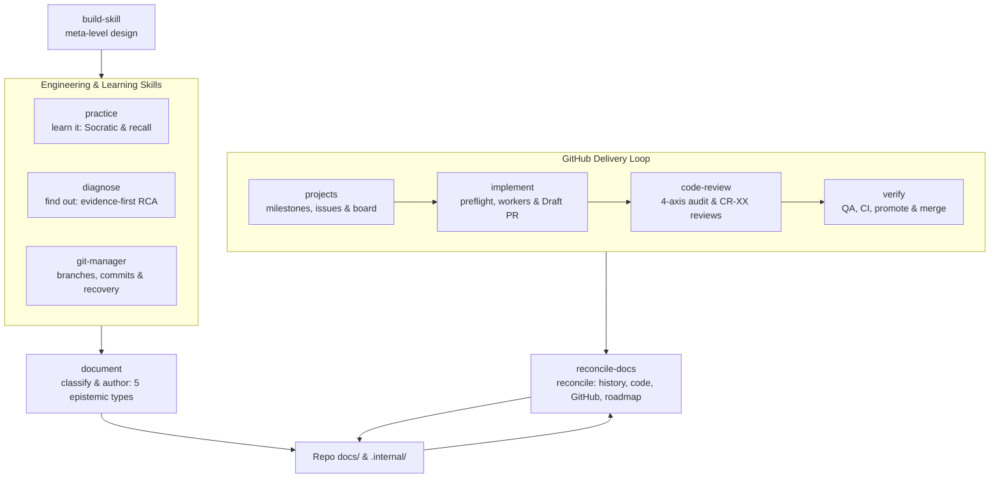

# Skills

**Modular, harness-agnostic skills for disciplined pair programming with coding agents.**

A collection of lightweight, single-purpose skills focused on low context overhead (≤80 lines), minimal ceremony, and user-approved state transitions. 

Designed to support critical systems thinking, active learning, disciplined engineering, and durable documentation across any compliant agent platform.

This collection was not designed for a Senior Software Engineer, but for learners, with the primary goal of maximizing long-term learning gains; the idea is to learn to think like a software engineer and architect, rather than simply producing code.

---

## Why Build Instead of Borrow?

There are many great Skills bundles out there, written by and for experienced developers to orchestrate automated "software factories". Many existing agent workflows optimize for experienced developers who want to delegate as much implementation work as possible. 

That is a reasonable goal, but it is not mine. As a learner, I need the workflow to preserve opportunities to reason, make decisions, debug, and build mental models.

Copying skills crafted for someone else's workflow imports their cognitive shortcuts, and assumptions. I believe that AI is useful for much more than only producing code. 

These skills exist to enforce four core principles:

1. **Defeating the Comprehension Illusion**: Having an AI generate code is not the same as understanding how a system behaves. When code velocity outpaces comprehension, you end up with systems you cannot debug when production breaks. Skills like `practice` make the learner write the code and drive analysis, ensuring mental models develop alongside the codebase.

2. **Intentional Epistemic Friction ("Your call")**: Great engineering requires deliberate checkpoints. Instead of letting agents make unilateral architectural choices, these skills pause at critical state transitions: requiring proven root causes before patching (`diagnose`), gating branch integration and merge readiness (`git-manager` / `verify`), or identifying learning opportunities that should be preserved as durable knowledge (`document`).

3. **Operational Ownership**: An agent should investigate, measure, and propose concrete options, but the human engineer must own the trade-offs, failure domains, and repository history. You cannot own what you did not decide.

4. **Radical Simplicity over Prompt Bloat**: Many third-party skills are brittle, multi-page prompts that consume context and hallucinate complex state machines. These skills adhere to strict line caps (≤80 lines for portable skills), the deletion test, and minimal ceremony.

---

## The System Architecture

The system is under active testing and continuous improvement. Currently, the skills form an orchestrated pair-programming workflow. `build-skill` governs meta-level skill design.

Three core operational skills (`practice`, `diagnose`, `git-manager`) structure day-to-day engineering, while a 4-skill GitHub-native delivery loop (`projects` -> `implement` -> `code-review` -> `verify`) handles planning, slice execution, static review, and merge closeout. `document` evaluates whether insights produced during work warrant durable preservation, and `reconcile-docs` keeps canonical repository docs aligned with code and optional GitHub state.



Every skill features an explicit **"Your call"** checkpoint where the agent pauses and asks the human to make critical architectural, diagnostic, and release decisions with 2-3 concrete options.

---

## Active Skills

### Portable Core (`skills/`)

| Skill | Trigger / Command | Purpose | Length |
| :--- | :--- | :--- | :--- |
| **[`practice`](skills/practice/SKILL.md)** | `/practice [topic]`, `/practice review` | Socratic tutoring, delayed retrieval, and hands-on Build-and-Break (`project-labs.md`: Ugly Heartbeat, primary specs, 30-line `scratch/` labs), Predict-Before-Run, and Code-Tracing drills with rubric calibration in gitignored `.internal/practice/`. | 57 lines |
| **[`diagnose`](skills/diagnose/SKILL.md)** | `/diagnose [symptom]` | Evidence-first troubleshooting. Progresses from raw logs to proven root cause and minimal, reversible fixes. | 49 lines |
| **[`git-manager`](skills/git-manager/SKILL.md)** | `/git-manager` | Repository hygiene, branch and worktree lifecycle, incremental Conventional Commits (autonomous on working branches in delivery mode; user-authored in learning mode), integration, conflict stops, and evidence-first reflog recovery. | 67 lines |
| **[`projects`](skills/projects/SKILL.md)** | `/projects` | Outer-loop GitHub planning: translates goals and specs into GitHub Milestones, Issues, and the canonical 5-column Projects v2 board with tiered sizing and zero-context reproducibility audits. | 75 lines |
| **[`implement`](skills/implement/SKILL.md)** | `/implement` | Orchestrates a ready GitHub vertical-slice issue via preflight checks, Step 1 delta-test decomposition, branch-scoped checkpointing, adaptive `test-writer`/`code-writer` workers, 1:1 commits, and Draft PR publishing. | 78 lines |
| **[`code-review`](skills/code-review/SKILL.md)** | `/code-review` | Inspects diffs and open GitHub PRs across four isolated axes (Spec & Scope, Standards & Smells, Seam & Test Integrity, Defensive Invariants), publishing monotonic `CR-XX` reviews and `RV-*` runtime checks via `build_review.py`. | 78 lines |
| **[`verify`](skills/verify/SKILL.md)** | `/verify` | Runs black-box runtime QA and remote CI inspection against `verdict=ready` PRs, posts the verification ledger, promotes Draft PRs (`gh pr ready`, `Work in Progress -> Review`), and executes human-gated merge closeout (`Review -> Completed`). | 75 lines |
| **[`gitea-to-github`](skills/gitea-to-github/SKILL.md)** | `/gitea-to-github` | On-demand cutover skill migrating standalone Gitea repos or `--org` batches to GitHub primary with a Gitea pull mirror, translating `.gitea/workflows/` to `.github/workflows/`, rewriting `AGENTS.md`, and migrating open issues idempotently. | 42 lines |
| **[`gt-usage`](skills/gt-usage/SKILL.md)** | `/gt-usage` | Standalone ad-hoc Gitea CLI (`gt`) utility outside the GitHub core delivery loop for querying or mutating Gitea entities and configuring sovereign Gitea remotes. | 46 lines |
| **[`document`](skills/document/SKILL.md)** | `/document` | Second-order knowledge classifier (Discussion, ADR, Plan, Debug Record, Knowledge) scoped to the active repository's `docs/` (or `.internal/`). User confirms type and provides core insight. | 55 lines |
| **[`reconcile-docs`](skills/reconcile-docs/SKILL.md)** | `/reconcile-docs [path]` | Reconciles historical evidence, present code reality, optional read-only GitHub delivery state, and future plans into canonical repo docs (`README`, `ARCHITECTURE`, `docs/adr/`, `ROADMAP`, `docs/designs/*.md`). | 45 lines |
| **[`build-skill`](skills/build-skill/SKILL.md)** | `/build-skill [topic]` | Interactive design, sizing, authoring, and empirical dogfooding of agent skills. Enforces design review gate before file creation. | 50 lines |
| **[`derive-skill`](skills/derive-skill/SKILL.md)** | `/derive-skill <url-or-path>` | Evaluates an external skill (source, license, scripts), sorts material into preserve/adapt/reject, and decides new skill, merge, or reject. Hands an approved derivation brief to `build-skill`. | 58 lines |
| **[`inspect-flake-update`](skills/inspect-flake-update/SKILL.md)** | `/inspect-flake-update` | Inspects updated flake.lock inputs, reviews upstream revisions, runs nix flake check, and drafts commit messages. | 46 lines |
| **[`nix-devshell`](skills/nix-devshell/SKILL.md)** | `/nix-devshell` | Authors, extends, validates, and troubleshoots project Nix development shells from repository evidence. | 76 lines |
| **[`tdd`](skills/tdd/SKILL.md)** | `/tdd` | Guides red-green test-driven development (Mode A) and test-suite hardening (Mode B) through public interface seams, boundary-only mocking, and non-tautological assertions. | 42 lines |

---

## Skill Interaction Matrix

| From \ To | Practice | Diagnose | Git Manager | Document | Reconcile Docs |
| :--- | :--- | :--- | :--- | :--- | :--- |
| **Practice** | - | yields for production incidents | learner writes message & runs commit | optional handoff on key insights | - |
| **Diagnose** | yields if user wants to find cause | - | branches, commits fix & recovers | hands off if RCA reveals non-obvious lesson | - |
| **Git Manager** | learner-controlled in practice/learning | manages branches & packages fixes | - | delegates if commit warrants deeper doc | provides commit history |
| **Document** | consumes practice milestones | consumes RCA findings | commits docs in repo `docs/` | - | provides ADRs and plans |
| **Reconcile Docs** | - | - | verifies commit reality & commits docs | audits ADRs, discussions, and plans | - |

---

## Canonical Flows

1. **Investigation to History**: `diagnose` (verify root cause) -> `git-manager` (checkpoint commit) -> `document` (optional Debug Record / ADR in `docs/`).
2. **Deliberate Practice to Knowledge**: `practice` (solve transfer challenge, log in `.internal/practice/`) -> `document` (optional durable knowledge article in `docs/knowledge/`).
3. **Documentation Reconciliation**: `reconcile-docs` (audit repo history, code reality, optional read-only GitHub state, roadmap) -> propose updates to `README` / `ARCHITECTURE` / `docs/adr/` / `ROADMAP` / `docs/designs/*.md` -> user approves.
4. **Skill Design Loop**: `build-skill` (approve spec) -> dogfood run -> minimal mechanism refinement.
5. **Branch Lifecycle & Integration**: `git-manager` (branch-before-edits or isolated worktree) -> implementation & incremental checkpoint commits -> `code-review` / `verify` -> `git-manager` (rebase or integration).
6. **GitHub Delivery Loop**: `projects` (tiered sizing, 5-column Projects v2 board, milestones, & falsifiable acceptance criteria) -> `implement` (preflight, Step 1 delta-test decomposition, branch-scoped checkpointing, adaptive `test-writer`/`code-writer` workers, & Draft PR) -> `code-review` (4-axis static audit, monotonic `CR-XX` PR reviews via `build_review.py`, & `RV-*` runtime checks) -> `verify` (black-box runtime QA, remote CI inspection, `gh pr ready` + `Work in Progress -> Review`, human-gated merge, & `Review -> Completed`).
7. **Gitea-to-GitHub Cutover**: `gitea-to-github` (dry-run inventory, backup snapshot, PR gate, `new-repo --empty --no-mirror --no-clone` push, `.gitea/workflows/` -> `.github/workflows/` & `AGENTS.md` translation, idempotent issue migration, archive rename, and `new-repo --gitea-mirror` pull-mirror swap) -> `projects` / `implement`.

---

## Installation & Portability

### CLI Prerequisites
- **`git`**: required for all repository, branch, and worktree workflows.
- **`gh` (GitHub CLI)**: primary forge CLI for the 4-skill GitHub delivery loop (`projects`, `implement`, `code-review`, `verify`), `gitea-to-github`, and optional read-only GitHub ingestion in `reconcile-docs` (authenticated with `repo` and `project` scopes).
- **`gt` (Gitea CLI)**: optional CLI required for `gt-usage` (ad-hoc Gitea operations) and `gitea-to-github` (Gitea-to-GitHub cutover).
- **`new-repo`**: optional repo-provisioning CLI used by `gitea-to-github` (`--empty --no-mirror --no-clone` and `--gitea-mirror`).

The repository includes an idempotent install script (`install.sh`) supporting both symlink and copy modes:

```bash
# Default install to ~/.gemini/config/skills (symlink mode)
./install.sh

# Verify installation health and detect missing skills
./install.sh check

# Install to custom harness path in copy mode
./install.sh --mode copy --target ~/.custom-agent/skills
```

When run:
- Portable skills and active extensions are linked/copied to the target directory.
- Retired legacy Gitea skills (`gitea-plan`, `implement-slice`, `verify-slice`, `gitea-pr`) and other obsolete skills are safely relocated to a dated backup directory (`skills.backup-<date>`).
- The global profile `profile/AGENTS.md` is installed as the user's base agent instruction.

---

## Behavioral Regression Testing

To ensure portable skills and GitHub delivery integrations maintain behavioral invariants across updates, run the deterministic regression test harness:

```bash
# Run full behavioral contract and invariant test suite
./tests/fixtures/run_regression.sh
```

Validates:
- Dynamic GitHub Projects v2 and milestone ID resolution rules (forbidding hardcoded Node IDs or guessed milestone numbers).
- Single-owner 5-column board state machine (`Backlog -> Ready -> Work in Progress -> Review -> Completed`) across `projects`, `implement`, and `verify`.
- `implement` preflight classifications, `--dry-run` zero-mutation contract, branch-scoped checkpointing, and OS-level non-interactive worker timeouts.
- `code-review` `build_review.py` monotonic `CR-XX` publishing, `cr-review-meta` stamping, diff-hunk validation, and exit codes.
- `verify` 3-phase QA/CI/promotion/merge closeout and `reconcile-docs` read-only GitHub ingestion.
- `gitea-to-github` safety flags, archive-before-mirror ordering, CI security guards, `<!-- gitea-origin: ... -->` idempotency, sibling handoffs, and `profile/AGENTS.md` zero-network session-start opt-out.
- `practice` Build-and-Break (`project-labs.md`), Predict-Before-Run, Code-Tracing, and `Reasoning trap` contracts.
- Skill line caps (≤80 lines), em-dash absence, valid relative markdown links, and path portability.

---

## Governing Design Rules

1. **One authoritative owner per rule.** If a rule belongs in `AGENTS.md`, do not restate it in every skill.
2. **The deletion test.** If deleting an instruction does not change agent behavior in a meaningful way, delete it.
3. **Plain words over jargon.** Prefer "decision" over "epistemic commitment", "steps" over "state machine".
4. **80 lines maximum for `SKILL.md`.** Deep templates and authoring specs live in `references/`.
5. **Human ownership of critical decisions.** The AI investigates, drafts, and proposes; the human approves the architecture, branch merges/releases, and document destinations.

---

## License

Released into the public domain under the [Unlicense](UNLICENSE.md).
