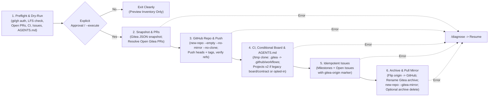

# `gitea-to-github` Migration Skill Design

*   **Author:** kiskaadee
*   **Status:** Draft
*   **Date:** 2026-11-26

--------------------------------------------------------------------------------

## Overview

`gitea-to-github` is an on-demand portable skill in `kiskaadee/skills` (`skills/gitea-to-github/SKILL.md`, `<= 80` lines) that migrates standalone repositories or Gitea organizations from self-hosted Gitea (`gt`) to GitHub (`gh` + `new-repo`, the user's repo-provisioning CLI), reconfiguring each migrated Gitea repository as an out-of-band pull mirror of GitHub. It handles full git history transfer, in-flight Gitea PR resolution, interactive curation of open issues and milestones, GitHub Projects v2 board onboarding, `.gitea/workflows/` CI pipeline migration to `.github/workflows/`, and `AGENTS.md` planning contract updates to `project_number: <int>`. In parallel, `profile/AGENTS.md` (the user-global session-start instruction file, distinct from per-repo `AGENTS.md`) adds a session-start check that detects Gitea `origin` remotes (when not explicitly marked sovereign/Gitea-only) and suggests running `/gitea-to-github`.

## The Problem

Following the migration of the core delivery loop (`projects`, `implement`, `code-review`, `verify`) and `reconcile-docs` to GitHub-native workflows, existing repositories hosted on self-hosted Gitea still face four migration barriers:

1.  **Manual multi-step repo and mirror inversion is error-prone:** Migrating a Gitea repository to GitHub primary + Gitea pull mirror requires creating an empty GitHub repository (`new-repo --empty --no-mirror --no-clone`), pushing branches and tags without Gitea's internal `refs/pull/*` refs, flipping local `origin`, archiving/replacing the source Gitea repository via `new-repo --gitea-mirror`, and aligning visibility (`internal` -> `private`). Deleting Gitea prematurely risks losing closed PRs, closed issues, releases, and webhooks if mirror creation fails.
2.  **CI pipelines target Gitea runners and context:** Existing `.gitea/workflows/` files reference `${{ gitea.* }}`, `GITEA_TOKEN`, Gitea action URLs, and Gitea runner labels, so they fail or remain inactive on GitHub Actions unless translated to `.github/workflows/`.
3.  **Open issues, milestones, boards, and legacy `AGENTS.md` contracts lag behind:** Repositories retain legacy `gitea-plan` `AGENTS.md` contracts (hardcoded Gitea board/column IDs and hex colors), open Gitea issues, and classic Gitea boards. Resuming an interrupted migration without an immutable provenance key risks duplicating GitHub issues.
4.  **Unmigrated repositories lack proactive discovery:** Agents starting work in an unmigrated Gitea repository only discover the forge mismatch after running a GitHub delivery skill (`projects`, `implement`, `verify`), rather than receiving a targeted migration suggestion at session start (while intentionally Gitea-only repositories need a way to opt out).

## Goals

*   **Safe, non-destructive repo and mirror inversion:** Create empty GitHub targets via `new-repo --empty --no-mirror --no-clone`, fail fast on Git LFS (`git lfs ls-files`), export a local Gitea API JSON snapshot before any destructive action, push all branches and tags cleanly, rename the Gitea source repo to `<repo>-archive-<timestamp>`, attach the Gitea pull mirror via `new-repo --gitea-mirror`, verify mirror sync, and delete the archive only upon explicit confirmation.
*   **Dry-run default and multi-repo organization migration:** Default to a read-only dry-run inventory table across standalone repos and Gitea organizations, segmenting clean-slate repos (sequential execution from one approval) from interactive-gated repos (open PRs or uncurated issues) before mutating either forge.
*   **CI pipeline migration:** Detect `.gitea/workflows/` and Gitea-targeting CI references, translate them to `.github/workflows/` (`${{ gitea.* }}` -> `${{ github.* }}`, `GITEA_TOKEN` -> `GITHUB_TOKEN`, GitHub-hosted `ubuntu-latest` default, or `self-hosted` opted in for `private` repos only), warn on unmigrated secrets, and commit them alongside any updated `AGENTS.md` in an ephemeral `/tmp/` clone before creating the Gitea pull mirror.
*   **Idempotent issue, milestone, and conditional board migration:** Stamp `<!-- gitea-origin: <gitea-host>/<owner>/<repo>#<number> -->` (with `<gitea-host>` derived from `origin` or active `gt` host config, normalized to lowercase hostname without scheme or port) in migrated GitHub issue bodies, paginate existing GitHub issues and milestones for `diagnose`-pause resumability, conditionally onboard issues to a 5-column Projects v2 board (only when a legacy Gitea board/contract exists or when explicitly opted in during dry-run, leaving new boards for boardless repos to `/projects`), and propose rewriting legacy `AGENTS.md` contracts to `project_number: <int>`.
*   **Zero-network session-start nudge with sovereign opt-out:** Update `profile/AGENTS.md` (user-global session-start instructions) to detect Gitea `origin` remotes via local git/file checks only and suggest `/gitea-to-github` (or flipping local `origin` via `git-manager` when `project_number:` is already present), skipping repositories that declare sovereign opt-out (`forge: gitea` in repo `AGENTS.md` or `git config --bool gitea.sovereign true`), and deferring live Gitea `mirror: true` verification to `/gitea-to-github` preflight.
*   **Repository compliance:** Keep `skills/gitea-to-github/SKILL.md` `<= 80` lines following `skills/build-skill/references/skeleton.md`, with zero `/home/<user>` paths, zero secrets, zero hardcoded instance URLs, and full coverage in `install.sh` and `tests/fixtures/test_skills_behavioral_contracts.py`.

## Non-Goals

*   **Migrating closed Gitea issues, closed PR review threads, wikis, webhooks, or Git LFS objects:** LFS fails fast; closed Gitea metadata (including closed issues, PRs, releases, and webhooks) is preserved in the local pre-archive JSON snapshot rather than replayed into GitHub. Because closed issues are skipped, open issues are re-numbered sequentially on GitHub (breaking `#N` cross-references).
*   **Auto-merging conflicting or unreviewed Gitea PRs:** Open PRs are surfaced in dry-run and require an explicit per-PR decision (`merge`, `push branch + recreate PR on GitHub`, `close`, or `abort`).
*   **Duplicating sibling skill rules:** `gt-usage` continues to own `gt` CLI conventions, `projects` continues to own Projects v2 / `AGENTS.md` schemas, and `git-manager` continues to own branch/commit hygiene.

## Open Questions

*   None. All architectural decisions and upstream `new-repo --empty` prerequisites are resolved in this document.

## Critical User Journeys (CUJs)

### CUJ 1: Standalone Repository Migration (With Open Issues, CI Workflows & Legacy `AGENTS.md`)

*   **Given**: A local checkout of a Gitea-hosted repository with open Gitea issues, a milestone, `.gitea/workflows/ci.yml`, and a legacy `gitea-plan` contract in `AGENTS.md`.
*   **When**: The user runs `/gitea-to-github` (dry-run default), reviews the plan, resolves any open Gitea PRs, curates which open issues to carry over, and approves execution.
*   **Then**:
    1.  `gitea-to-github` exports a local Gitea JSON snapshot to `$XDG_STATE_HOME/gitea-to-github-backup/<repo>/` (`0700`/`0600` permissions), creates the empty GitHub repo via `new-repo --empty --no-mirror --no-clone` (matching visibility), and pushes explicit `refs/heads/*:refs/heads/*` and `refs/tags/*:refs/tags/*` refspecs.
    2.  In an ephemeral `/tmp/` clone, it translates `.gitea/workflows/ci.yml` to `.github/workflows/ci.yml`, creates/links the 5-column Projects v2 board (triggered by the legacy `gitea-plan` contract), rewrites `AGENTS.md` to `project_number: <int>` (upon user approval), commits and pushes those changes to GitHub, and migrates selected open issues/milestones with `<!-- gitea-origin: <gitea-host>/<owner>/<repo>#<number> -->` markers.
    3.  If a local checkout exists, it delegates flipping local `origin` to GitHub and dirty-tree resolution to `git-manager`; it renames the Gitea repo to `<repo>-archive-<timestamp>`, attaches the Gitea pull mirror via `new-repo --gitea-mirror`, verifies sync, and deletes the archive only if the user explicitly confirms.

### CUJ 2: Organization Migration & Mid-Flight `diagnose` Resume

*   **Given**: A Gitea organization containing multiple repositories (some active, some intentionally sovereign or already pull mirrors).
*   **When**: The user runs `/gitea-to-github --org <gitea-org>`, reviews the dry-run inventory table (segmented into clean-slate vs. interactive-gated repos), approves execution, and hits an unexpected API/network error mid-migration.
*   **Then**: `gitea-to-github` pauses and hands off to `/diagnose`; once resolved, re-running `/gitea-to-github` inspects existing GitHub repos, issues (`<!-- gitea-origin: ... -->` markers), and milestones to resume sequentially without duplicating repositories, issues, or milestones.

### CUJ 3: Session-Start Nudge & Sovereign Opt-Out

*   **Given**: A developer opens an agent session inside a repository whose `origin` remote points to Gitea.
*   **When**: The repository is a normal unmigrated Gitea repo vs. an intentionally sovereign repo (`forge: gitea` in `AGENTS.md` or `git config --bool gitea.sovereign true`) vs. a stale local clone already carrying `project_number:` in `AGENTS.md`.
*   **Then**: `profile/AGENTS.md` performs a zero-network local check, suggests `/gitea-to-github` at session start for unmigrated repos, advises flipping local `origin` to GitHub via `git-manager` when `project_number:` is already present, and stays silent for sovereign repos (while `/gitea-to-github` preflight handles live `mirror: true` detection).

--------------------------------------------------------------------------------

## Technical Plan (Architecture)

### System Topology & Migration Flow

`gitea-to-github` acts as an on-demand orchestrator over existing CLI/skill boundaries (`gt-usage` for Gitea queries, `new-repo` for GitHub empty creation and Gitea pull-mirror attachment, `git-manager` for local remote/commit hygiene, `projects` for Projects v2 / `AGENTS.md` schemas, and `diagnose` for mid-flight error recovery).

### Execution Modes & Dry-Run Default

1.  **Default Dry-Run Mode:** Invoking `/gitea-to-github` (standalone or `--org <gitea-org>`, with `--dry-run` accepted as an optional explicit flag) always runs a read-only discovery pass first and halts before any mutation unless `--execute` or explicit approval is given. Passing `--execute` skips the initial confirmation gate only for `clean-slate` repos; `interactive-gated` repos still pause for per-PR and issue-curation prompts.
2.  **Segmented Org Selection & Sequential Execution:** When targeting a Gitea organization, the dry-run discovery pass paginates Gitea org/repo/issue/PR API queries, classifies every repository (`migratable`, `already-pull-mirror`, `sovereign-opt-out`, `has-lfs-blocked`, `has-open-prs`, `has-open-issues`, `empty`, `archived`) into a single inventory table, and segments selected repositories into:
    *   **Clean-slate:** Repositories with zero open PRs and no per-item curation required; executed sequentially from one approval (applying any user-stated overrides such as visibility or target org).
    *   **Interactive-gated:** Repositories with open PRs or open issues needing curation; handled per-repo with explicit interactive prompts before mutation.

### Git, `new-repo --empty`, & Safe Mirror Swap

1.  **Visibility, Mirror, Dirty-Path, State & LFS Pre-Checks:** Check live Gitea mirror status (skipping already-mirrored repos) and Git LFS usage (failing fast if LFS objects exist). Unarchive `archived: true` Gitea repos only on explicit approval if they are selected for migration, and handle `empty` (0-commit) repos without running git branch pushes or `/tmp/` commits. If a local checkout exists, check working-tree status specifically for `AGENTS.md` and `.gitea/workflows/`: if uncommitted edits exist on those paths, prompt the user to commit or stash them via `git-manager` first, or continue via `/tmp/` and skip the post-swap local `git pull`. Map Gitea `public` -> GitHub `public`, `private` -> GitHub `private`, and `internal` -> GitHub `private` (with an explicit warning). If the target GitHub repo already exists and is `private`, update the Gitea repo to `private` before mirroring.
2.  **Pre-Migration Snapshot & Open PR Gate:** Export a local Gitea API JSON snapshot (open/closed issues, PRs, milestones, releases, and webhooks) under `$XDG_STATE_HOME/gitea-to-github-backup/<repo>/` (falling back to `~/.local/state/gitea-to-github-backup/<repo>/`) with `umask 077` (`0700`/`0600` permissions). Never auto-merge conflicting or unreviewed Gitea PRs; dry-run lists every open PR with draft/mergeable/CI status and requires a per-PR choice (`merge` on Gitea, `push branch + recreate PR on GitHub`, `close`, or `abort`) before cloning/pushing.
3.  **Empty GitHub Creation & Idempotent Ref Push:** Create the empty GitHub target via `new-repo --empty --no-mirror --no-clone` (skipping creation if the target GitHub repo already exists on resume). Clone Gitea into a temp bare repo and push explicit `refs/heads/*:refs/heads/*` and `refs/tags/*:refs/tags/*` refspecs (avoiding Gitea internal refs such as `refs/pull/*`). On resume, verify whether Gitea branch tips are already ancestors of GitHub's branches before pushing (never force-pushing over Step 4 commits). Set GitHub's default branch to match Gitea's and verify `HEAD`, branch list, and tag list align.
4.  **Ephemeral `/tmp/` Clone Commit & Non-Destructive Archive Swap:**
    *   Check whether the planned CI and/or contract updates for that repository are already present on GitHub before re-running Step 4; if missing, apply `.github/workflows/` and `AGENTS.md` updates inside an ephemeral `/tmp/` clone of the newly pushed GitHub repository and push to GitHub *before* creating the Gitea pull mirror, decoupling remote migration from local working-tree state.
    *   Only *after* GitHub refs, CI workflows, `AGENTS.md`, and open issues are verified on GitHub:
        *   If a local checkout exists, delegate flipping local `origin` to GitHub, dirty-tree resolution, and pulling the migration commit (unless skipped due to colliding local edits) to `git-manager`.
        *   Rename the source Gitea repository to `<repo>-archive-<timestamp>` (truncating the base name if needed to stay within Gitea's 100-character repository name limit).
        *   Attach the Gitea pull mirror via `new-repo --gitea-mirror <github-url> [-p] [--gitea-org <gitea-org>]` (passing private-repo credentials per `new-repo`'s mirror auth contract) and poll Gitea's mirror status endpoint until the first sync succeeds or times out.
        *   Ask for explicit user confirmation under the skill's destructive-action gate (aligned with `profile/AGENTS.md`) before deleting `<repo>-archive-<timestamp>`.

### CI Pipeline Migration (`.gitea/workflows/` -> `.github/workflows/`)

Before creating the Gitea pull mirror, `gitea-to-github` inspects `.gitea/workflows/*.yml|yaml` (and Gitea CI badges/URLs in `README.md`):
*   Moves workflow files from `.gitea/workflows/` to `.github/workflows/` inside the ephemeral `/tmp/` clone.
*   Translates Gitea-specific expressions and secrets: `${{ gitea.* }}` -> `${{ github.* }}`, `secrets.GITEA_TOKEN` / `GITEA_TOKEN` -> `secrets.GITHUB_TOKEN` / `GITHUB_TOKEN`. Extracts any non-`GITEA_TOKEN` `${{ secrets.* }}` references and warns the user during dry-run / Step 4 so those secrets can be provisioned on GitHub.
*   Maps `runs-on:` labels: defaults to GitHub-hosted `ubuntu-latest` for both public and private repos, and maps to `self-hosted` only on explicit user opt-in during dry-run review when target GitHub visibility is `private` (blocking `self-hosted` on `public` repos to prevent PR supply-chain exposure).
*   Flags third-party or Gitea-hosted action URLs (`https://<gitea-host>/...`) for user review/replacement and commits/pushes the migrated `.github/workflows/` from the `/tmp/` clone before mirror creation.

### Idempotent Issue, Milestone, Conditional Projects v2 & `AGENTS.md` Migration

1.  **Milestones & Issues:** Query existing GitHub milestones and issues using paginated GitHub milestones and issues endpoints (filtering out pull requests), alongside paginated Gitea issue/milestone queries. Match milestones by `title` (creating missing ones with `description` and omitting null/zero `due_on` timestamps). Pre-create missing GitHub labels before creating issues, and warn if curated Gitea issue bodies contain `/attachments/<uuid>` URLs that would break once `<repo>-archive-<timestamp>` is deleted. Embed `<!-- gitea-origin: <gitea-host>/<owner>/<repo>#<number> -->` (with `<gitea-host>` derived from `origin` or active `gt` host config, normalized to lowercase hostname without scheme or port) at the bottom of each migrated GitHub issue body and skip any issue whose origin marker already exists on GitHub.
2.  **Conditional Projects v2 Onboarding:** Only create or link a 5-column GitHub Projects v2 board (`Backlog`, `Ready`, `Work in Progress`, `Review`, `Completed`) when the source repo has a legacy Gitea board/contract or when the user explicitly opts in during dry-run; otherwise leave new board setup to `/projects` (respecting its tiered `Project Board Policy`, which marks boards `Omitted` for `Small`-tier work and `Recommended`/`Required` for `Medium`/`Large` tiers). Delegate all Projects v2 GraphQL mutations strictly to `skills/projects/references/github-projects-v2.md`, placing migrated issues in `Backlog` (or their mapped legacy Gitea column).
3.  **`AGENTS.md` Rewrite:** Detect legacy `gitea-plan` contracts in repo `AGENTS.md` (Gitea `project_id`, `{column -> id}` maps, hex colors) and propose rewriting them to the state-free `project_number: <int>` schema from `skills/projects/references/planning-contract.md`. Commit and push `AGENTS.md` + `.github/workflows/` in the `/tmp/` clone *before* creating the Gitea pull mirror so both forges stay in sync.

### Global Session-Start Trigger (`profile/AGENTS.md`)

`profile/AGENTS.md` adds a strictly local, zero-network session-start check:
1.  Inspect local `origin` remote to check if it points to the configured Gitea host.
2.  Skip immediately if `origin` is already GitHub, if repo `AGENTS.md` declares sovereign opt-out (`forge: gitea`), or if `git config --bool gitea.sovereign` is `true`.
3.  Otherwise, if `project_number:` is already present in repo `AGENTS.md`, warn that local `origin` still points to Gitea and advise flipping `origin` to GitHub via `git-manager`; if `project_number:` is absent, inform the user that the repository uses Gitea as `origin` and suggest running `/gitea-to-github` (leaving live Gitea API `mirror: true` verification to `/gitea-to-github` preflight).

### Component Architecture & `<= 80`-Line Partitioning

*   **`skills/gitea-to-github/SKILL.md` (`<= 80` lines):** Follows `skills/build-skill/references/skeleton.md` (`Use when`, `Steps`, `Your call`, `Done when`, `Hands off to`), acting as a phase router with `Suggested Next Step:` emission (the standard handoff line printed at skill completion, suppressed when invoked by another skill) and explicit triggers to `references/` and sibling skills (`gt-usage`, `projects`, `git-manager`, `diagnose`).
*   **`skills/gitea-to-github/references/remote-and-mirror.md`:** `new-repo --empty` invocation, explicit `refs/heads/*` + `refs/tags/*` refspec push, resume ancestry/phase guards, visibility mapping (`internal` -> `private`), `$XDG_STATE_HOME/gitea-to-github-backup/<repo>/` Gitea JSON snapshot (`umask 077`), preflight dirty-path check (`AGENTS.md`, `.gitea/workflows/`), ephemeral `/tmp/` clone commits, `git-manager` delegation for local remote flip, truncated `<repo>-archive-<timestamp>` rename, `new-repo --gitea-mirror` + polling/timeout verification, and explicit-confirmation archive deletion.
*   **`skills/gitea-to-github/references/ci-and-contracts.md`:** `.gitea/workflows/` -> `.github/workflows/` translation rules (`gitea.*` -> `github.*`, `GITEA_TOKEN` -> `GITHUB_TOKEN`, non-`GITEA_TOKEN` secret extraction warnings, `runs-on:` defaults with `public`-repo `self-hosted` block) and legacy `AGENTS.md` -> `project_number: <int>` rewrite rules.
*   **`skills/gitea-to-github/references/entity-migration.md`:** Segmented dry-run inventory table (`clean-slate` vs. `interactive-gated`, including `empty` and `archived` states), open PR resolution rules, `<!-- gitea-origin: ... -->` dedup algorithm (`gh api --paginate`, normalized `<gitea-host>`), label pre-creation, `/attachments/` warnings, null `due_on` omission, milestone & conditional Projects v2 delegation (`skills/projects/references/github-projects-v2.md`), and `diagnose` pause/resume state recovery.

--------------------------------------------------------------------------------

## Non-Functional Requirements

*   **Sequential Safety & Resumability:** Org migrations execute sequentially per-repo using `gh` and `gt` CLI defaults, and any mid-flight error pauses for `/diagnose`; re-running `/gitea-to-github` uses phase-detection guards, branch ancestry checks, and `<!-- gitea-origin: ... -->` markers to resume idempotently without duplicating entities.
*   **Portability & Hygiene:** Zero `/home/<user>` paths, zero hardcoded instance URLs (`gitea.roadtotech.me` stays solely in `profile/AGENTS.md`), zero em-dashes, and `SKILL.md <= 80` lines (enforced by `tests/fixtures/test_skills_behavioral_contracts.py`).

--------------------------------------------------------------------------------

## Risks & Mitigations

| Risk | Impact | Mitigation |
| :--- | :--- | :--- |
| Data loss if Gitea repo is deleted before pull mirror syncs | Permanent loss of closed PRs/issues/releases/webhooks | Export local Gitea JSON snapshot (including releases/webhooks), rename Gitea repo to `<repo>-archive-<timestamp>`, verify `new-repo --gitea-mirror` sync first, and require explicit confirmation before deleting archive. |
| Security: private metadata exposure in backups or `self-hosted` runner RCE | Local secret/data leak or homelab runner compromise | Store JSON snapshots under `$XDG_STATE_HOME` with `umask 077` (`0700`/`0600`); block `self-hosted` runners on `public` repos and warn on unmigrated `${{ secrets.* }}` and Gitea-hosted action URLs. |
| Scalability: large org/repo pagination & secondary GitHub rate limits | Silent item truncation or mid-batch `403`/`429` failures | Use `gh api --paginate` and paginated Gitea queries; execute org batches sequentially with idempotent `<!-- gitea-origin: ... -->` resume on `/diagnose` retry. |
| Auto-merging conflicting/unreviewed Gitea PRs | Broken `main` pushed to GitHub | Never auto-merge; dry-run lists open PRs and requires explicit per-PR choice (`merge`, `recreate on GitHub`, `close`, or `abort`). |
| Resume overwriting Step 4 commits or failing on existing GitHub repo | Non-fast-forward rejection or aborted `/diagnose` retry | Skip `new-repo --empty` if GitHub repo exists; verify branch ancestry before pushing; skip Step 4 if the planned CI and/or contract updates for that repository are already present on GitHub. |
| Uncommitted local changes blocking CI/contract commit | Dirty working tree or mixed commits | Check `AGENTS.md` and `.gitea/workflows/` dirty paths in preflight; commit changes in an ephemeral `/tmp/` clone and delegate local remote/pull handling to `git-manager`. |
| Broken `/attachments/` URLs or `#N` re-numbering after closed-issue skip | Dead attachment links or shifted issue cross-references | Warn on `/attachments/<uuid>` URLs in curated issues before archive deletion; document `#N` re-numbering as a Non-Goal trade-off. |
| Prompting intentionally sovereign Gitea repos or missing stale `origin` | Developer friction or accidental push to read-only Gitea mirror | Zero-network local check in `profile/AGENTS.md` (`forge: gitea` / `git config gitea.sovereign` opt-out; still warn to flip `origin` via `git-manager` when `project_number:` is present). |

--------------------------------------------------------------------------------

## Alternatives Considered

### Alternative 1: Use `gh repo create` Directly Instead of `new-repo --empty`

*   **Summary:** Leave `new-repo` unchanged (where `--no-clone` still passes `auto_init=True` when no local `.git` exists) and invoke `gh repo create` directly from `gitea-to-github` to provision empty GitHub target repositories.
*   **Pros:** Avoids any upstream change to `new-repo` and eliminates an external prerequisite for standalone skill execution.
*   **Cons:** Splits repository provisioning across two tools (`new-repo` for normal creation and raw `gh repo create` inside `gitea-to-github`), losing `new-repo`'s centralized org targeting, visibility validation, and consistent Gitea mirror orchestration.
*   **Reason for Rejection:** Keeping `new-repo` as the single repo-provisioning entry point preserves consistent behavior across standalone and mirrored repo creation; `--empty` (`auto_init=False`) is a minimal, reusable upstream addition in `new-repo` (`6f9f07b`).

### Alternative 2: Single-Repo Scope with Separate `/projects` Handoff

*   **Summary:** Limit `gitea-to-github` to single-repository git/issue migration and delegate organization batching to a wrapper script while handing off Projects v2 onboarding and `AGENTS.md` updates to a separate `/projects` invocation.
*   **Pros:** Smaller initial `gitea-to-github` skill surface and strict separation between git forge migration and project-board setup.
*   **Cons:** Forces N sequential manual prompts across multi-repo organizations and leaves migrated repos without a working `project_number` or Projects v2 board until a second skill is run manually, breaking the pre-mirror commit guarantee (requiring extra post-mirror commits).
*   **Reason for Rejection:** Supporting segmented org dry-run selection plus conditional Projects v2 + `AGENTS.md` `project_number` updates (when legacy boards/contracts exist or when opted in) ensures both GitHub and the new Gitea mirror inherit the complete contract in one pass without forcing boards onto repos that do not need them.

### Alternative 3: Omit Session-Start Gitea-Origin Trigger from `profile/AGENTS.md`

*   **Summary:** Rely exclusively on users remembering to invoke `/gitea-to-github` manually rather than adding a session-start check in `profile/AGENTS.md`.
*   **Pros:** Zero startup check overhead and zero risk of prompting on intentionally Gitea-hosted repositories.
*   **Cons:** Legacy Gitea repositories and outdated `AGENTS.md` contracts go unnoticed during normal engineering sessions, stalling adoption of the GitHub-centered delivery workflow.
*   **Reason for Rejection:** A strictly local, zero-network session-start check in `profile/AGENTS.md` surfaces legacy Gitea repos (and stale `origin` remotes on migrated repos) proactively without homelab coupling, while explicit opt-outs (`forge: gitea` in `AGENTS.md`, `git config --bool gitea.sovereign true`) prevent prompting intentionally sovereign repos.

### Alternative 4: In-Place Gitea `DELETE` Before `--gitea-mirror` and Title-Only Issue Deduplication

*   **Summary:** Delete the original Gitea repository immediately after pushing git refs to GitHub so `new-repo --gitea-mirror` can recreate it at the same slug, and deduplicate migrated issues by matching issue titles on GitHub.
*   **Pros:** Slightly fewer API calls during swap and no temporary `<repo>-archive-<timestamp>` repository to clean up.
*   **Cons:** Immediate `DELETE` creates an irreversible data-loss window if mirror creation or network calls fail mid-flight; title-only issue matching silently collides or skips distinct Gitea issues that share a title.
*   **Reason for Rejection:** Exporting a local Gitea JSON snapshot, renaming to `<repo>-archive-<timestamp>` until explicit deletion confirmation, and embedding an immutable `<!-- gitea-origin: <gitea-host>/<owner>/<repo>#<number> -->` marker prevent premature-deletion data loss and title-based issue collisions.

--------------------------------------------------------------------------------

## Future Improvements

*   **Git LFS Object Migration:** Support optional `git lfs fetch --all` and `git lfs push --all` for repositories that store large binary assets, rather than failing fast in preflight.
*   **Closed History & Webhook Migration:** Optional flag to import closed Gitea issues, PR review threads, wikis, or Gitea-to-GitHub webhook equivalents beyond the local JSON snapshot.
*   **Automated Multi-Workflow Matrix Validation:** Run `actionlint` or dry-run workflow syntax validation against translated `.github/workflows/*.yml` files when available in the environment.

## Detailed Implementation Plan

> **Upstream Prerequisite Status:** `new-repo --empty --no-mirror --no-clone` (empty GitHub repo creation with `auto_init=False`) and the GitHub-primary + Gitea pull-mirror inversion (`--gitea-mirror <github-url>`, `--gitea-org <gitea-org>`) are already implemented and verified in `~/Projects/active/new-repo` (`6f9f07b`, 48/48 tests passing). All remaining changes below live in `kiskaadee/skills`.

### File Changes Overview

| Component / File | Type / Scope | Summary |
| :--- | :--- | :--- |
| `skills/gitea-to-github/SKILL.md` | Create (`<= 80` lines) | Phase-router skill entrypoint following `skeleton.md`. |
| `skills/gitea-to-github/references/remote-and-mirror.md` | Create | Preflight, JSON backup, git ref push, `/tmp/` commit, archive rename, and pull mirror swap. |
| `skills/gitea-to-github/references/ci-and-contracts.md` | Create | `.gitea/workflows/` to `.github/workflows/` CI and `AGENTS.md` contract migration rules. |
| `skills/gitea-to-github/references/entity-migration.md` | Create | Segmented `--org` dry-run inventory, milestone/issue dedup, and conditional Projects v2 rules. |
| `profile/AGENTS.md` | Modify | Update `new-repo` mirror wording and add local session-start Gitea-origin check. |
| `skills/projects/SKILL.md` | Modify | Reference `/gitea-to-github` in Step 1 legacy Gitea fallback. |
| `skills/projects/references/planning-contract.md` | Modify | Reference `/gitea-to-github` in Section 3 legacy Gitea contract detection. |
| `skills/gt-usage/SKILL.md` | Modify | Add `gitea-to-github` under `## Hands off to`. |
| `install.sh` | Modify | Add `gitea-to-github` to `ACTIVE_PORTABLE_SKILLS` in sorted order. |
| `tests/fixtures/test_skills_behavioral_contracts.py` | Modify | Register `gitea-to-github` in `EXPECTED_SKILLS` and add behavioral contract tests. |

### Phased Execution & Gate Checks

#### Phase 1: Create `skills/gitea-to-github/`
*   **`skills/gitea-to-github/SKILL.md` (`<= 80` lines):** Follow `skills/build-skill/references/skeleton.md` (`name: gitea-to-github`, `## Use when`, `## Steps` in order: `Preflight & Dry-Run Plan -> Resolve PRs -> Push Git & Provision GitHub -> Projects v2 (if applicable) -> Translate CI & AGENTS.md (in /tmp/ clone) -> Migrate Issues -> Archive Rename & Pull Mirror -> Optional Archive Delete`, `## Your call`, `## Done when`, `## Hands off to` linking `projects`, `implement`, `gt-usage`, `diagnose`). Include `Suggested Next Step:` routing and zero `/home/<user>` paths, em-dashes, or hardcoded private domains.
*   **`skills/gitea-to-github/references/remote-and-mirror.md`:**
    *   Preflight: verify `gt`, `gh`, `new-repo --empty --no-mirror --no-clone`, live Gitea `mirror: true` status, `git lfs ls-files` fail-fast, `empty`/`archived` repo classification, and dirty-path checks on `AGENTS.md` and `.gitea/workflows/`.
    *   Backup & PR gate: export Gitea JSON snapshot (issues, PRs, milestones, releases, webhooks) to `$XDG_STATE_HOME/gitea-to-github-backup/<repo>/` (fallback `~/.local/state/gitea-to-github-backup/<repo>/`) under `umask 077` (`0700`/`0600`); require per-PR choice (`merge`, `push branch + recreate PR`, `close`, `abort`).
    *   GitHub provisioning & push: **must invoke `new-repo <target> --empty --no-mirror --no-clone [-o <gh-org>] [-p]` from a fresh non-git temporary directory (`mktemp -d`)** so `new_repo.py`'s `determine_target()` never sees `.git` and never triggers `link_and_push_existing()` to prematurely overwrite local `origin`. Push explicit `refs/heads/*:refs/heads/*` and `refs/tags/*:refs/tags/*` refspecs from a temp bare clone; on resume, skip `new-repo --empty --no-mirror --no-clone` if the GitHub repo exists and check branch ancestry before pushing.
    *   Local checkout & archive swap: apply CI/`AGENTS.md` commits in an ephemeral `/tmp/` clone (skipping if planned updates are already present on GitHub); delegate local `origin` flip and `git pull` to `git-manager`. Rename Gitea repo to `<repo>-archive-YYYYMMDDHHMMSS` (UTC `YYYYMMDDHHMMSS`; `-archive-YYYYMMDDHHMMSS` is 23 chars, so truncate `<repo>` base name to `<= 77` chars to respect Gitea's 100-char limit). Attach pull mirror via `new-repo --gitea-mirror <github-url> [-p] [--gitea-org <gitea-org>]`, trigger `POST /api/v1/repos/{owner}/{repo}/mirror-sync`, and poll `GET /api/v1/repos/{owner}/{repo}` plus default-branch commit SHA parity against GitHub every `3s` up to a `60s` timeout. Delete `<repo>-archive-YYYYMMDDHHMMSS` only on explicit confirmation.
*   **`skills/gitea-to-github/references/ci-and-contracts.md`:**
    *   Translate `.gitea/workflows/` to `.github/workflows/` (`${{ gitea.* }}` -> `${{ github.* }}`, `GITEA_TOKEN` -> `GITHUB_TOKEN`, default `runs-on: ubuntu-latest`, allow `self-hosted` only on explicit opt-in for `private` repos and block on `public` repos). Extract non-`GITEA_TOKEN` `${{ secrets.* }}` references and warn the user.
    *   Automatically rewrite standard Gitea workflow badge URLs in `README.md` to GitHub Actions badge URLs when the corresponding workflow is migrated; flag non-standard Gitea-hosted action or badge URLs for user review.
    *   Rewrite legacy `AGENTS.md` planning contracts (`project_id`, column maps, `gitea-plan`) to `project_number: <int>` inside the `/tmp/` clone before mirror attachment.
*   **`skills/gitea-to-github/references/entity-migration.md`:**
    *   Emit segmented `--org` dry-run inventory table (`clean-slate` vs. `interactive-gated`, including `empty` and `archived`, using paginated Gitea queries).
    *   Migrate open milestones via `gh api --paginate repos/{owner}/{repo}/milestones?state=all` (matching by title, omitting null/zero `due_on`). Pre-create missing GitHub labels, warn on `/attachments/<uuid>` URLs, and deduplicate open issues via `gh api --paginate repos/{owner}/{repo}/issues?state=all` (filtering `select(.pull_request == null)`) using `<!-- gitea-origin: <gitea-host>/<owner>/<repo>#<number> -->` (`<gitea-host>` derived from `origin` or active `gt` host config, normalized lowercase hostname).
    *   Conditionally create/link a 5-column Projects v2 board (`Backlog`, `Ready`, `Work in Progress`, `Review`, `Completed`) via `skills/projects/references/github-projects-v2.md` only when a legacy Gitea board/contract exists or when explicitly opted in. Map legacy Gitea board columns case-insensitively (`To Do`/`Open` -> `Backlog`, `Ready` -> `Ready`, `In Progress`/`Doing` -> `Work in Progress`, `Review` -> `Review`, `Done`/`Closed` -> `Completed`; fallback `Backlog`).
*   **Phase 1 Gate:** Verify `wc -l skills/gitea-to-github/SKILL.md <= 80` and confirm all four files exist with zero `/home/<user>` paths or private domains.

#### Phase 2: Update `profile/AGENTS.md` and Sibling Skills
*   **`profile/AGENTS.md`:** Update L74 `"GitHub push mirroring"` wording for `new-repo` to `"Gitea pull mirroring"`. Under `## Homelab and connectivity` (L76), add a strictly local, zero-network session-start Gitea-origin check (`git remote -v` / `get-url origin`) that suggests `/gitea-to-github` (or flipping local `origin` via `git-manager` when `project_number:` is already present), skipping repos with `forge: gitea` in repo `AGENTS.md` or `git config --bool gitea.sovereign true`.
*   **`skills/projects/SKILL.md` (Step 1) & `skills/projects/references/planning-contract.md` (Section 3):** Explicitly reference `/gitea-to-github` alongside standalone `gt-usage` in legacy Gitea fallback guidance.
*   **`skills/gt-usage/SKILL.md` (`## Hands off to`):** Add `gitea-to-github` for repositories ready to migrate from Gitea to GitHub.
*   **Phase 2 Gate:** Review `git diff` across `profile/AGENTS.md`, `skills/projects/`, and `skills/gt-usage/` for consistency and zero broken relative links.

#### Phase 3: Register Installer & Behavioral Contract Tests
*   **`install.sh`:** Insert `gitea-to-github` in alphabetical order between `git-manager` and `gt-usage` in `ACTIVE_PORTABLE_SKILLS`.
*   **`tests/fixtures/test_skills_behavioral_contracts.py`:** Add `"gitea-to-github"` in sorted order to `EXPECTED_SKILLS`, update `test_skill_inventory_and_skeletons` (L454) docstring from `15` to `16` active skills, and add `"gitea-to-github"` to `test_chained_skills_include_suggested_next_step_routing` (L261) (or validate its `Suggested Next Step:` and relative links in the new test). Add behavioral contract assertions verifying dry-run default, LFS fail-fast, `new-repo --empty --no-mirror --no-clone` from a non-git dir, archive-before-mirror rename, `<!-- gitea-origin: ... -->` idempotency, `.gitea/workflows/` -> `.github/workflows/` CI migration, and `profile/AGENTS.md` sovereign opt-out (`forge: gitea` / `git config` `gitea.sovereign`).
*   **Phase 3 Gate:** Run `./install.sh check` and `./tests/fixtures/run_regression.sh` and confirm all checks pass with exit code `0`.

## Verification Plan

1.  **Installation & Parity Checks:**
    *   Run `./install.sh check` (and `./install.sh` to sync local agent symlinks/copies) and confirm zero missing or stale skill registrations.
2.  **Automated Behavioral Contract Suite:**
    *   Run `./tests/fixtures/run_regression.sh` and confirm all unit and regression checks pass with exit code `0` (covering `<= 80` lines, zero em-dashes, zero `/home/` paths, relative links, and `gitea-to-github` / `profile/AGENTS.md` behavioral contracts).
3.  **Portability Hygiene Check (Beyond Automated Suite):**
    *   Verify zero hardcoded private domains (such as `gitea.roadtotech.me`) appear anywhere inside `skills/gitea-to-github/`.
4.  **Manual Dry-Run & End-to-End Smoke Verification (Post-Implementation):**
    *   Run `/gitea-to-github` in default dry-run mode against a test Gitea repository with `.gitea/workflows/`, a legacy `AGENTS.md`, an open issue, and a milestone; confirm the emitted plan accurately previews changes without mutating Gitea or GitHub.
    *   Run `/gitea-to-github --org <gitea-org>` in dry-run mode and confirm the inventory table accurately segments `clean-slate` vs. `interactive-gated` (plus `empty`/`archived`/`sovereign-opt-out`) repositories (CUJ 2).
    *   Test `profile/AGENTS.md` session-start behavior on an unmigrated Gitea repo vs. sovereign opt-out (`forge: gitea` and `git config --bool gitea.sovereign true`) vs. stale `project_number:` repo (CUJ 3).
    *   Execute an end-to-end test migration on a disposable test repository and confirm: GitHub repo creation via `new-repo --empty --no-mirror --no-clone` from `mktemp -d`, `.github/workflows/` and `AGENTS.md` (`project_number: <int>`) committed in `/tmp/` prior to mirror swap, `<repo>-archive-YYYYMMDDHHMMSS` created, Gitea pull mirror attached and SHA-synced within `60s`, and re-running issue migration creates zero duplicate issues.
