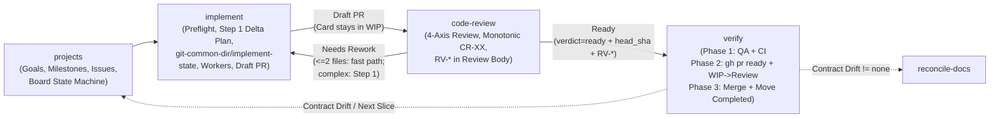

# GitHub-Centered Delivery Ecosystem Redesign

*   **Author:** kiskaadee
*   **Status:** Proposed
*   **Date:** 2026-11-25

--------------------------------------------------------------------------------

## Overview

This design migrates the primary planning, issue tracking, and pull request delivery workflows in `kiskaadee/skills` from a homelab-hosted Gitea instance (`gt`) to **GitHub Projects v2** (`gh` CLI and `gh api`). Gitea remains an out-of-band pull mirror of GitHub repositories (`gt-usage` stays installed as a standalone utility outside the delivery loop). GitHub-hosted runners serve as the default CI environment for both public and private repositories; an optional self-hosted `github_runner` on `server-local` (the homelab host) is available per repository only when a private repo approaches the 2,000 free minutes/month limit or requires homelab resources.

In parallel, the legacy Gitea delivery skills (`gitea-plan`, `implement-slice`, `verify-slice`, `gitea-pr`) are refactored into **4 GitHub-native core skills** (`projects`, `implement`, `code-review`, `verify`), plus an updated `reconcile-docs` skill. Every `SKILL.md` must adhere to `skills/build-skill/references/skeleton.md` (standardized frontmatter, trigger structure, and `Suggested Next Step:` routing), stay `<= 80` lines, enforce one owner per rule, and will be verified by `tests/fixtures/test_skills_behavioral_contracts.py` and `install.sh`.

## The Problem

The current skill ecosystem (`gitea-plan`, `implement-slice`, `code-review`, `verify-slice`, `gitea-pr`, `reconcile-docs`) is tightly coupled to a self-hosted Gitea instance on `server-local`, and suffers from four operational pain points:

1.  **Homelab uptime blocks all planning and PR work:** Whenever `server-local` is offline (power loss, maintenance, or residential ISP WAN IP rotation with ~5-minute DNS propagation lag), issue creation, board transitions, PR reviews, and merges halt. Moving Gitea to a paid VPS would solve uptime, but adds recurring hosting cost and external server maintenance.
2.  **Tangled skill ownership and ceremony:** `implement-slice` currently mixes preflight, decomposition, worker delegation, inline `verify-slice`, inline `code-review`, Gitea time tracking, board moves, and integration routing. Meanwhile, `gitea-pr` splits PR creation (post-QA) from PR triage and closeout, and `reconcile-docs` hardcodes Gitea `gt` queries.
3.  **Broken cross-pass review traceability:** `code-review` resets its `CR-01..CR-NN` finding counter on every review pass of the same PR, causing ID collisions across rework rounds, omits `RV-*` (Runtime Verification) checks from the published PR review body so a fresh verification session cannot recover them, and risks `422 Unprocessable Entity` failures when inline comments target deleted or non-diff lines.
4.  **Unbounded subagent hangs and installer blind spots:** Subagents occasionally hang for 8+ minutes on interactive CLI prompts (`/dev/tty` or stdin) or stalled network/lock calls with no OS-level timeout guard. In addition, `install.sh check` unconditionally exits `0` even when required skills are missing or obsolete symlinks remain, and `install.sh` does not prune dangling symlinks pointing into the skills repository.

## Goals

*   **Decouple planning and PR workflows from homelab uptime:** All 4 core delivery skills (`projects`, `implement`, `code-review`, `verify`) and `reconcile-docs`'s GitHub read path operate natively against GitHub (`gh` CLI and `gh api`), validating GitHub repository identity via `gh repo view --json url` on forge-dependent operations.
*   **Simplify the delivery loop to 4 core skills with clear single ownership:**
    *   `projects` owns outer-loop goals, milestones/due dates, vertical-slice issues, and the canonical 5-column board state machine (`Backlog -> Ready -> Work in Progress -> Review -> Completed`).
    *   `implement` absorbs Step 1 delta-test decomposition and a sole-owned branch-scoped plain-text `todo.txt`-format checkpoint under `$(git rev-parse --git-common-dir)/implement-state/<branch_slug>.txt` (read/written directly without invoking `tuxedo`), executes slices with adaptive subagent isolation (`1-worker` fast path for trivial `<= 2`-file fixes; `test-writer` and `code-writer` with per-task lint/typecheck/docstring hygiene for multi-task slices), and publishes/syncs a Draft PR while keeping the board card in `Work in Progress`.
    *   `code-review` performs post-Draft-PR 4-axis static review (including non-documentation-drift checks) with persistent monotonic per-PR `CR-XX` IDs, deterministic `build_review.py` payload validation, `verdict=ready|needs_rework` + `RV-*` runtime checks in the review body, and split rework routing.
    *   `verify` owns black-box runtime QA, remote CI inspection, `verdict=ready` / `head_sha` validation, Draft PR promotion (`gh pr ready`, transitioning `Work in Progress -> Review`), human-gated merge, post-merge `Review -> Completed` transition, and drift chaining.
*   **Prevent hung subagent CLI calls deterministically:** Enforce OS-level non-interactive command wrapping (`setsid timeout -k 10 <N>s <cmd> < /dev/null`) with tiered timeouts inside worker prompts.
*   **Maintain strict repository invariants and atomic branch cutover:** Every `SKILL.md` stays `<= 80` lines with zero em-dashes, zero `/home/<user>` paths, and zero secrets; `install.sh` returns non-zero on `check` failures and prunes repo-scoped dangling symlinks; `tests/fixtures/test_skills_behavioral_contracts.py` and `tests/fixtures/run_regression.sh` pass; cutover executes atomically on a dedicated feature branch validated against one real private-repo slice before merging to `main`.

## Non-Goals

*   **Dual-forge adapter layers in core skills:** Gitea is strictly an out-of-band pull mirror; `gt-usage` remains installed as an independent standalone utility and is not wired into `projects`, `implement`, `code-review`, `verify`, or `reconcile-docs`.
*   **Standalone `gh-usage` skill:** Standard `gh` CLI flags do not require a dedicated skill; the 3 non-obvious `gh api`/GraphQL recipes (Projects v2 GraphQL Node IDs, REST milestones, commit-pinned inline reviews + paginated `CR-XX` lookup) live in `skills/projects/references/` and `skills/code-review/references/`.
*   **Renaming `git-manager` to `git`:** Excluded to avoid touching 17+ files (including 7 unrelated skills) and colliding with the `git` CLI binary.
*   **Automated `release` skill and per-repo Gitea-to-GitHub migration:** Automated releases are deferred until a project goes through its first manual release. Per-repo Gitea-to-GitHub migration (mirror inversion, issue migration, and legacy `AGENTS.md` conversion) is tracked as a dedicated follow-up issue (`gitea-to-github` skill).
*   **`diagnose` post-mortem suggestion:** Deferred as an independent follow-up after the 4-skill GitHub loop is live.
*   **Homelab `github_runner` NixOS/systemd implementation code:** This design specifies the operational hardening contract for opt-in `github_runner` deployments (`--ephemeral`, container/VM isolation, egress-only LAN firewall, resource caps, concurrency 2), while infrastructure manifests belong in the `canopy` infrastructure repository.

## Open Questions

*   None. Initial exploration was captured in the brainstorm RFC; this document is the canonical resolved specification.

## Critical User Journeys (CUJs)

### CUJ 1: End-to-End Multi-Task Feature Slice on a GitHub Repo

*   **Given**: A GitHub-hosted repository with `project_number` recorded in `AGENTS.md`, `gh` authenticated with `project` and `repo` scopes, and a ready vertical-slice issue `#42`.
*   **When**: The user runs `implement` on issue `#42`, then `code-review` on the resulting Draft PR, addresses any findings, and runs `verify`.
*   **Then**:
    1.  `implement` runs preflight (verifying a clean working tree on a non-`main` branch or worktree and moving `#42` `Ready -> Work in Progress`) and decomposes delta tests in Step 1.
    2.  `implement` tracks resume checkpoints in plain `todo.txt` format inside `$(git rev-parse --git-common-dir)/implement-state/<branch_slug>.txt` (read/written directly), runs `test-writer` / `code-writer` (with per-task lint, typecheck, docstrings, and `Why:` comments), deletes the state file, and opens a Draft PR (`Closes #42`) while leaving `#42` in `Work in Progress`.
    3.  `code-review` audits the Draft PR, computes `max_id` deterministically via `skills/code-review/scripts/build_review.py` across paginated prior reviews/comments, and publishes one `head_sha`-pinned `--comment` review containing `<!-- cr-review-meta: max_id=NN head_sha=<sha> verdict=ready|needs_rework -->` and `RV-*` runtime checks.
    4.  `verify` confirms the latest `cr-review-meta` matches `head_sha` with `verdict=ready`, runs `RV-*` runtime checks and inspects `gh pr checks`, posts the verification ledger, promotes the PR (`gh pr ready`), moves `#42` `Work in Progress -> Review`, and on human approval merges the PR and executes `Review -> Completed`.

### CUJ 2: Trivial Localized Fix or Rework Pass (Fast Path)

*   **Given**: An open Draft PR with a localized `code-review` finding (or a `<= 2`-file bugfix with no new test seam).
*   **When**: `code-review` routes the localized finding to `implement` (or the user invokes `implement` directly).
*   **Then**: `implement` runs preflight, auto-skips Step 1 decomposition, executes via a single worker with OS-level timeout wrapping, commits and pushes to the existing Draft PR branch, updates the Draft PR body if scope changed, and leaves the board card in `Work in Progress` for the next `code-review` pass (which continues numbering from `CR-(NN+1)` without colliding with earlier IDs).

### CUJ 3: Atomic Feature-Branch Cutover & Installer Verification

*   **Given**: An existing local installation of `kiskaadee/skills` with legacy Gitea skills symlinked in `~/.gemini/config/skills/`.
*   **When**: All new skills, updated retained skills, legacy skill deletions, `OBSOLETE_SKILLS` updates, `install.sh` fixes, and updated contract tests land together on a dedicated feature branch, and `./install.sh` is run from that branch to validate one live GitHub slice before merging to `main`.
*   **Then**: `./install.sh check` exits non-zero whenever required skills are missing or obsolete symlinks remain, `python3 -m unittest tests/fixtures/test_skills_behavioral_contracts.py` and `tests/fixtures/run_regression.sh` pass, legacy symlinks are backed up and pruned cleanly, and `git checkout main && ./install.sh` rolls back cleanly with zero dangling symlinks.

--------------------------------------------------------------------------------

## Technical Plan (Architecture)

### System Topology & Delivery Loop

The delivery ecosystem is organized into 4 GitHub-native core skills (`projects`, `implement`, `code-review`, `verify`), plus `reconcile-docs` updated for GitHub read-only ingestion. Among supporting skills outside the core loop, `diagnose` and `document` remain unchanged, while `git-manager`, `tdd`, and `gt-usage` are updated only for handoff and cross-reference alignment.



### Canonical Board State Machine & Single Ownership

`projects` is the sole owner of the 5-column GitHub Projects v2 board schema (`skills/projects/references/planning-contract.md` and `skills/projects/references/github-projects-v2.md`):

| Column | Fixed GitHub Color Enum | Entering Transition Owner | Trigger Event |
| :--- | :--- | :--- | :--- |
| `Backlog` | `GRAY` | `projects` (or `verify` on abort) | Issue created, or abandoned Draft PR closed |
| `Ready` | `BLUE` | `projects` | Slice prioritized and ready for execution |
| `Work in Progress` | `YELLOW` | `implement` (or `verify` on merge rejection) | Preflight passes (`Ready -> Work in Progress`); stays here through Draft PR open, `code-review`, and rework; human merge rejection at `verify` Phase 3 runs `gh pr ready --undo` and moves `Review -> Work in Progress` |
| `Review` | `PURPLE` | `verify` | Phase 2 passes QA + CI + `verdict=ready` gate and runs `gh pr ready` (`Work in Progress -> Review`) |
| `Completed` | `GREEN` | `verify` | Phase 3 merges PR and executes `Review -> Completed` directly |

### Repository `AGENTS.md` Planning Contract Schema

Each GitHub-managed repository stores minimal, human-readable coordinates in its `AGENTS.md` (no rotating sprint state and no brittle GraphQL Node IDs):

```yaml
# Planning Contract (owned by projects)
project_number: <int>
```

**Split Dynamic GraphQL Resolution:** `skills/projects/references/github-projects-v2.md` separates board onboarding from card transitions:
*   **Onboarding (`projects`):** Uses `owner.projectV2(number: $project_number)` to resolve `project_id` for `addProjectV2ItemById` when creating or onboarding new issues not yet on the board.
*   **Card transitions (`implement`, `verify`):** Uses `issue.projectItems` filtered by `project.number == $project_number` to resolve `project_id`, `status_field_id`, the issue's `PVTI_...` item ID, and target column `option_id`s in a single query matching the canonical 5 column names (`Backlog`, `Ready`, `Work in Progress`, `Review`, `Completed`). This avoids 100-item board pagination limits and fails fast with a clear mismatch error if a board's Status column names do not match.

**Scoped GitHub remote guard:** Forge-dependent operations (`projects`, `implement`, `verify`, PR publishing in `code-review`, and optional GitHub-state reads in `reconcile-docs`) verify GitHub repository identity via `gh repo view --json url` (supporting SSH host aliases and non-`origin` remotes). Local-only modes (local diff reviews in `code-review`, local git/doc reconciliation in `reconcile-docs`) run without requiring a GitHub remote. If a forge-dependent step fails `gh repo view --json url` or detects a legacy Gitea `AGENTS.md` planning contract, it fails fast advising to migrate the repo to GitHub or use standalone `gt-usage`.

### Component Architecture & `<= 80`-Line Partitioning

Every `SKILL.md` acts strictly as an invariant and transition router (`<= 80` lines) with mandatory trigger pointers (`Before <step>, read references/<file>.md`) and `Suggested Next Step: /<skill> <args>` emission on standalone turns (suppressed when delegated to a subagent, per `skills/build-skill/references/skeleton.md`).

#### 1. `projects` (Replaces `gitea-plan`)

*   **`SKILL.md` (`<= 80` lines):** Outer-loop planning workflow: verify GitHub repo via `gh repo view --json url`, reconcile specs/roadmaps with GitHub Issues and Projects v2 board state (handing off to `reconcile-docs` when docs lag), select ceremony tier (`Small` / `Medium` / `Large`), create/update milestones and vertical-slice issues, run Independent Zero-Context Reproducibility Audit (`Medium`/`Large`), and hand off ready issues to `implement`.
*   **`references/planning-contract.md` (Sole owner):** `AGENTS.md` `project_number` contract schema, canonical 5-column state machine, transition ownership table, and scoped GitHub remote guard.
*   **`references/tiers-and-audit.md`:**
    *   `Small` / `Medium` / `Large` ceremony matrix (`Small`: 1-3 issues, single milestone; `Medium`: 4-8 vertical slices + clean-room audit; `Large`: phased milestones + cross-slice dependency map + clean-room audit) and vertical-slice criteria.
    *   Independent Zero-Context Reproducibility Audit checklist: a fresh-context subagent audits `Medium`/`Large` plans with zero prior conversation history to confirm every slice is executable without guesswork, returning an `Auditor Report Schema` (verdict, gaps/ambiguities, and required plan edits).
*   **`references/github-projects-v2.md` (Sole owner of GitHub planning recipes):** `owner.projectV2(number: $project_number)` onboarding for `addProjectV2ItemById`, `issue.projectItems` (filtered by `project.number == $project_number`) dynamic Node ID resolution, `DATE` and `SINGLE_SELECT` mutations, fixed color enum map, and REST milestone commands (`gh api repos/{owner}/{repo}/milestones`). Referenced by `implement` and `verify` for board moves.

#### 2. `implement` (Replaces `implement-slice`, Absorbs Decomposition & Ephemeral State)

*   **`SKILL.md` (`<= 80` lines):** Orchestrator loop (mutates only its branch-scoped checkpoint file directly; never writes production code, never writes tests, never performs code review):
    1.  **Preflight:** Verify GitHub repo via `gh repo view --json url`, classify working tree (`CLEAN_BASE`: clean tree on base branch; `EXISTING_SLICE_BRANCH`: clean tree on the target slice's own non-`main` branch with an active checkpoint file or open Draft PR, allowing resume and rework to proceed directly; `ADOPTABLE_DIFF`: uncommitted changes matching the target slice; `CONFLICTING_STATE`: dirty/unrelated changes or mid-merge/rebase, halt; `WRONG_BASE`: branch diverged from expected base, halt/re-branch), create/switch to non-`main` branch or worktree via `git-manager`, and move card `Ready -> Work in Progress`.
    2.  **Step 1 (Delta-Test Decomposition):** Inspect existing tests on affected seams (`covered (keep green)`, `partial/weak (harden)`, `missing (new Red test)`). Auto-skip for trivial `<= 2`-file localized fixes with no new test seam. If `--dry-run`, print plan and halt with zero mutations. Otherwise record slice tasks directly in plain `todo.txt` format (`<task>` / `x YYYY-MM-DD <task>`) inside `$(git rev-parse --git-common-dir)/implement-state/<branch_slug>.txt` (`branch_slug="${branch//\//__}"`) without invoking `tuxedo`.
    3.  **Execution Loop:** Dispatch adaptive subagents (1-worker fast path for auto-skipped trivial fixes; `test-writer` -> `code-writer` with per-task lint/typecheck, docstrings on new/modified public symbols, `Why:` comments, and affected local markdown updates for multi-task slices), commit 1:1 per completed deliverable via `git-manager`, and mark tasks done in `"$state_file"`.
    4.  **Draft PR & State Cleanup:** Open or sync Draft PR (`gh pr create --draft`, `Closes #<N>`, `Contract Drift: none | <summary>`), delete `"$state_file"`, keep card in `Work in Progress`, and hand off to `code-review`.
*   **`references/preflight.md` (Sole owner):**
    *   Working-tree classifications (`CLEAN_BASE`, `EXISTING_SLICE_BRANCH`, `ADOPTABLE_DIFF`, `CONFLICTING_STATE`, `WRONG_BASE`) and `--dry-run` contract.
    *   Branch-scoped `$(git rev-parse --git-common-dir)/implement-state/<branch_slug>.txt` checkpoint lifecycle in plain-text `todo.txt` line format (so external `todo.sh`/`tuxedo` [terminal `todo.txt` CLI/TUI] can inspect it if desired), read/written directly by `implement` without invoking `tuxedo`, and deleted on Draft PR open/sync or explicit abort/escalation to `projects` (halting on `CONFLICTING_STATE` or `WRONG_BASE` leaves existing files untouched).
*   **`references/decomposition-and-roles.md`:**
    *   Step 1 delta-test rubric and `<= 2`-file fast-path criteria (including bailout to Step 1 if scope grows).
    *   `test-writer` / `code-writer` contracts, 3-4 task worker recycling to prevent context bloat, and 2-turn `test-writer`/`code-writer` deadlock circuit breaker (escalate to human owner or `diagnose`).
    *   Mandatory OS-level non-interactive command wrapper embedded in worker prompts: `setsid timeout -k 10 <N>s <cmd> < /dev/null` with `CI=true`, `GIT_TERMINAL_PROMPT=0`, `PAGER=cat`, and tiered timeouts (60s CLI, 180s unit tests, 600s cold builds).
*   **`references/pr-and-drift.md` (Sole owner):** Draft PR body template, rework sync rules, and fixed-format `Contract Drift: none | <summary>` marker (where Contract Drift means any implementation deviation from issue acceptance criteria, public interfaces/schemas, `ARCHITECTURE.md`, or `ROADMAP.md` specs).

#### 3. `code-review` (Upgraded for GitHub, `build_review.py` & Monotonic `CR-XX`)

*   **`SKILL.md` (`<= 80` lines):** Select review tier (`Lightweight`: small localized diffs; `Standard`: multi-file feature slices; `High-Assurance`: security, auth, schema, or >500-line diffs requiring an isolated Axis 3 subagent), run 4-axis audit, and publish whenever invoked on an open GitHub PR (verified via `gh repo view --json url`). When no open PR exists or local-only mode is active, skip PR publishing and explicitly state in output that no open PR was found and findings are reported locally. Route `Needs Rework` -> `implement` (fast path or Step 1) and `Ready` -> `verify`.
*   **`references/axes.md`:** 4-axis rubric (`Spec & Scope`, `Standards & Smells` with explicit non-documentation-drift checks for missing docstrings, stale comments, lint/format regressions, and affected local markdown, `Seam & Test Integrity`, `Defensive Invariants`) and tier selection criteria.
*   **`references/finding-schema.md` (Sole owner of finding lifecycle & GitHub PR review API):**
    *   Monotonic `CR-XX` algorithm & `build_review.py` integration: paginate `GET /repos/{owner}/{repo}/pulls/{n}/reviews` and `GET /repos/{owner}/{repo}/pulls/{n}/comments`, extract `max_id` deterministically outside LLM context via `skills/code-review/scripts/build_review.py` parsing `cr-review-meta` markers and `^### CR-(\d+)` headings, and start new findings at `max + 1` (`CR-01`..`CR-99`, `CR-100`).
    *   Duplicate-SHA / pending-review guard keyed on `(head_sha, verdict)` before posting (skip re-posting only when a review with the same `(head_sha, verdict)` already exists, allowing `verdict=ready` to supersede `verdict=needs_rework` on the same commit after Exit B/C triage), plus `max 3 rework-cycle cap` enforcement before human escalation (counted from prior `verdict=needs_rework` `cr-review-meta` entries on the PR).
    *   `POST /repos/{owner}/{repo}/pulls/{n}/reviews` payload built by `build_review.py` (`side: "LEFT"` for deletions, `side: "RIGHT"` for additions/modifications, moving cross-file/missing-file/out-of-hunk findings into `### Findings (Unanchored / Cross-File)` in the review body to prevent `422` errors).
    *   Publish `<!-- cr-review-meta: max_id=NN head_sha=<sha> verdict=ready|needs_rework -->` and collapsible `RV-*` runtime checks (`local` vs. `live-infra`, explicit `FAIL if ...` signals) inside the PR review body.
    *   Findings start in `Pending Triage` (with no `Accepted Trade-off` status) until closed via one of 3 exits: **Exit A** (fix in-branch), **Exit B** (promote to a GitHub Issue, optionally paired with `TODO(#<N>): ...` or `Why:` + ADR link in `docs/decisions/`), or **Exit C** (dismiss as invalid/false positive). Record Exit B (`Promoted to #<N>`) and Exit C (`Dismissed: <reason>`) closures in the superseding `Ready` review body's triage summary so `code-review` emits `verdict=ready` only when zero unresolved `Pending Triage` findings remain.
*   **`scripts/build_review.py`:** Stdlib-only Python helper validating PR diff hunks, routing unanchorable findings to the review body, formatting `^### CR-NN` headers, extracting `max_id`, and stamping `cr-review-meta`.

#### 4. `verify` (Replaces `verify-slice` + Closing Half of `gitea-pr`)

*   **`SKILL.md` (`<= 80` lines):** Precondition: existing GitHub PR (verified via `gh repo view --json url`; no manual PR fallback). Structured into 3 linear phases (plus explicit abort invocation via `closeout-and-abort.md` when closing an abandoned/superseded Draft PR):
    1.  **Phase 1 (Read-Only Runtime QA + CI):** Verify latest `cr-review-meta` matches exact current `head_sha` and `verdict=ready` (block and route to `code-review` if missing, stale, or `needs_rework`), execute `RV-*` checks with explicit dispositions, and inspect `gh pr checks` (on red CI, inspect `gh run view --log-failed` and hand off to `diagnose` or `implement`).
    2.  **Phase 2 (Promotion):** Post final Verification Ledger comment, promote PR (`gh pr ready`), and move board card `Work in Progress -> Review` (per `skills/projects/references/github-projects-v2.md`).
    3.  **Phase 3 (Human Merge Gate + Closeout):** Present verification packet for human merge authorization; on approval, merge PR, execute `Review -> Completed` directly via `issue.projectItems`, and chain `reconcile-docs` + `projects` when `Contract Drift: != none`. On human rejection, run `gh pr ready --undo` and move `Review -> Work in Progress`.
*   **`references/qa-dispositions.md`:** Risk-proportional QA matrix, `local` vs. `live-infra` boundaries, falsifiable `FAIL if ...` format, and 5 dispositions (`PASS`, `FAIL`, `BLOCKED (env/fixture)`, `BLOCKED (out-of-bounds)`, `INCONCLUSIVE`).
*   **`references/closeout-and-abort.md`:** Verification Ledger comment template, post-merge `Review -> Completed` GraphQL mutation, and abandoned/superseded Draft PR abort path (`gh pr close` + revert board card to `Backlog`, entered only when explicitly invoked to abort a Draft PR).

#### 5. `reconcile-docs` (Updated for GitHub)

*   **`SKILL.md` (`<= 80` lines):** Preserve local git/doc reconciliation for all repositories; scope optional PR/board ingestion to GitHub via `gh repo view --json url`; update handoffs from `gitea-plan`/`implement-slice` to `projects`/`implement`.
*   **`references/reconciliation-matrix.md`:** Replace `gt pr` and Gitea tracker commands with `gh pr list --state merged`, `gh api` milestones/reviews, and Projects v2 board inspection.
*   **`references/doc-contracts.md`:** Replace `implement-slice` Step 1 reference with `implement` preflight.

--------------------------------------------------------------------------------

## Non-Functional Requirements

### Security & Privacy

*   **Public skill repository hygiene:** Zero secrets, tokens, or absolute `/home/<user>` paths anywhere in `kiskaadee/skills` (enforced by contract tests and secret scans).
*   **Opt-in self-hosted `github_runner` isolation (operational contract for `canopy`):** Repositories opting into `github_runner` must scope it strictly to private repositories (public repos use free GitHub-hosted runners), run `--ephemeral` runners inside isolated containers/VMs with per-job workspace/cache isolation, and enforce egress-only firewall rules blocking RFC1918 homelab LAN access (except DNS) to prevent supply-chain RCE from pivoting across the LAN.

### Performance, Latency & Token Economics

*   **Skill context budget:** Every `SKILL.md` stays `<= 80` lines; detailed procedures load lazily via explicit `references/` triggers.
*   **Subagent token & stability bounds:** Trivial `<= 2`-file fixes take the 1-worker fast path (avoiding cold-start overhead). Multi-task slices recycle `test-writer`/`code-writer` every 3-4 tasks to prevent quadratic cumulative token growth and stale-file assumptions. Hard caps stop runaway loops: 2-turn `test-writer`/`code-writer` deadlock breaker and max 3 `code-review -> implement` rework cycles before human escalation.
*   **`code-review` payload scaling:** Extracting `max_id` deterministically inside `skills/code-review/scripts/build_review.py` keeps raw prior review JSON out of LLM context (`O(1)` token overhead regardless of rework rounds).
*   **Opt-in homelab runner capacity:** Start opt-in `github_runner` at concurrency 2 with systemd `MemoryMax`/`CPUQuota` caps to prevent parallel Nix/Rust/Docker builds from OOM-killing `server-local`.

### Rollout & Rollback

*   **Atomic feature-branch cutover:** Implement all new skills (`projects`, `implement`, `verify`, `build_review.py`), retained-skill updates (`code-review`, `reconcile-docs`, `git-manager`, `tdd`, `gt-usage`), legacy deletions (`gitea-plan`, `implement-slice`, `verify-slice`, `gitea-pr`), `OBSOLETE_SKILLS` updates, `install.sh` fixes, and contract tests together on one dedicated feature branch. Run `./install.sh` from that branch and validate one real private-repo slice end-to-end before merging to `main`.
*   **Rollback:** `install.sh` prunes broken symlinks in `$TARGET_DIR` pointing into `$SCRIPT_DIR/skills/*` and backs up replaced/obsolete skills to a timestamped directory, so `git checkout main && ./install.sh` restores the legacy Gitea loop cleanly with zero dangling symlinks.

--------------------------------------------------------------------------------

## Risks & Mitigations

| Risk / Limit | Impact | Mitigation |
| :--- | :--- | :--- |
| GitHub PR Review API `422` on deleted/non-diff lines | Wedges `code-review` publishing | `skills/code-review/scripts/build_review.py` enforces `side: "LEFT"` for deletions and moves out-of-hunk/cross-file findings into the top-level review body. |
| GitHub API rate limits or large PR pagination | Truncated `CR-XX` scan or GraphQL failure | Paginate `/reviews` and `/comments` via `gh api --paginate` parsed outside LLM context; query `issue.projectItems` directly instead of full-board scans. |
| Partial-failure split-brain (PR merged, board move fails) | Card stranded in `Review` | `verify` Phase 3 executes `Review -> Completed` idempotently; re-running `verify` or `projects` reconciles the board state safely. |
| Opt-in `github_runner` outage or shared cache poisoning | Private-repo CI blocked >24h or cross-repo leak | Keep GitHub-hosted runners as default; for opt-in `github_runner`, enforce `--ephemeral` isolated caches and document `gh run rerun --failed` (24h unclaimed job limit is a known limit). |
| Git worktree state isolation for `implement` checkpoints | Branch collisions or stale state | Store checkpoints at `$(git rev-parse --git-common-dir)/implement-state/<branch_slug>.txt` (`/` sanitized to `__`), isolated per branch and deleted on Draft PR open or abort. |

--------------------------------------------------------------------------------

## Alternatives Considered

### Alternative A: Deploy Gitea on a Dedicated Paid VPS

*   **Pros**: Eliminates residential ISP WAN IP lag and homelab power/connectivity outages while keeping existing `gt`-based skills (`gitea-plan`, `gitea-pr`, `implement-slice`) mostly intact.
*   **Cons**: Adds recurring cloud hosting cost and external server maintenance, while undermining the purpose of operating a homelab for self-hosted services. Still lacks native Projects v2 `DATE` fields and requires maintaining custom `gt` workflows.
*   **Reason for Rejection**: Contradicts operating a homelab while adding paid hosting overhead; moving planning/PR workflows to GitHub Projects v2 solves uptime without a VPS.

### Alternative B: 5-Skill Core Loop with Standalone `decompose` and Root `todo.txt` Bus

*   **Pros**: Separates slice planning (`decompose`) from execution (`implement`), and surfaces slice progress in root `todo.txt` and `slice-implementation.md`.
*   **Cons**: Forces `implement` to support two entry paths, adds a cross-session `slice-implementation.md` artifact, leaks untracked root `todo.txt` across branch switches and worktrees, and requires `verify` to handle post-merge `todo.txt` cleanup.
*   **Reason for Rejection**: Folding Step 1 decomposition and a branch-scoped `git-common-dir/implement-state` checkpoint into `implement` eliminates `slice-implementation.md`, dual entry paths, and cross-skill `todo.txt` cleanup while keeping the core loop at 4 skills.

### Alternative C: Dual-Forge Semantic Adapter (`gh-usage` + `gt-usage`) Across All Core Skills

*   **Pros**: Keeps Gitea-hosted repositories as first-class citizens inside `projects`, `implement`, `code-review`, `verify`, and `reconcile-docs` via a shared adapter interface.
*   **Cons**: GitHub Projects v2 (GraphQL Node IDs, fixed color enums, `line`/`side` inline reviews) and Gitea (`gt` REST CLI, hex colors, `new_position` inline reviews) have structurally different APIs and state machines. Maintaining parity doubles contract-test surface for a forge being retired from active SDLC workflows.
*   **Reason for Rejection**: Keeping core skills GitHub-native eliminates cross-forge state-machine drift while `gt-usage` remains installed as a standalone utility.

### Alternative D: Keep a Thin Standalone `gh-usage` Skill

*   **Pros**: Provides a single `/gh-usage` entry point for ad-hoc `gh api` or GraphQL queries outside the 4 core skills, and avoids cross-referencing `skills/projects/references/github-projects-v2.md` from `implement` and `verify`.
*   **Cons**: Adds an extra skill directory, `install.sh` entry, and contract-test fixture to hold only 3 non-obvious recipes (`Projects v2 GraphQL`, `REST milestones`, and `commit-pinned inline PR reviews`), since standard `gh` CLI flags do not require a dedicated skill.
*   **Reason for Rejection**: Inlining the 3 `gh api`/GraphQL recipes into `skills/projects/references/` and `skills/code-review/references/` is simpler and aligns with single rule ownership.

### Alternative E: Rename `git-manager` to `git`

*   **Pros**: Shorter skill name matching the 1-word naming of `projects`, `implement`, and `verify`.
*   **Cons**: Touches 17+ repository files including 7 completely unrelated skills (`build-skill`, `derive-skill`, `diagnose`, `document`, `inspect-flake-update`, `nix-devshell`, `practice`), solves zero stated pain points, and collides visually and semantically with the `git` CLI binary in prose and slash commands.
*   **Reason for Rejection**: High cross-repo churn with no functional benefit.

### Alternative F: Move Board Cards to `Review` Immediately on Draft PR Creation

*   **Pros**: Binary board semantics (`Work in Progress` = coding, `Review` = PR open), without waiting for `verify` to promote the PR.
*   **Cons**: Places cards in `Review` while autonomous `code-review`, CI, and rework loops are still mutating the branch, adding merge-queue noise and requiring reverse `Review -> Work in Progress` transitions on rework.
*   **Reason for Rejection**: Keeping Draft PRs in `Work in Progress` and moving `Work in Progress -> Review` only on `gh pr ready` keeps `Review` as a dedicated human merge queue.

--------------------------------------------------------------------------------

## Future Improvements

*   **`gitea-to-github` migration skill:** Dedicated follow-up skill for on-demand per-repo migration (mirror inversion, Gitea-to-GitHub issue migration, and legacy `AGENTS.md` conversion, plus a stale-contract check in `profile/AGENTS.md` once available).
*   **Educational release-planner skill:** Future skill combining `projects` + `practice` scoped to the release stage (comparing SemVer/CalVer/GitHub Releases/Nix flake pins, flagging over-engineering, and guiding a first manual release) before building an automated `release` skill.
*   **`diagnose` post-mortem note suggestion:** Minor independent enhancement prompting `diagnose` to suggest capturing root-cause findings via `document`.

--------------------------------------------------------------------------------

## Detailed Implementation Plan

All changes execute atomically on a dedicated feature branch created from `main` before editing. No implementation code is included here; every file path below defines the exact behavioral scope and rationale.

### Target Files to Create, Modify, or Delete

#### New Skill: `projects` (Replaces `gitea-plan`)
1.  **`skills/projects/SKILL.md` (Create)**
    *   **Type / Scope**: Portable Skill (`<= 80` lines, follows `skills/build-skill/references/skeleton.md`).
    *   **Proposed Changes**: Outer-loop GitHub planning workflow: verify GitHub repo via `gh repo view --json url`, reconcile specs/roadmaps with GitHub Issues and Projects v2, select ceremony tier, manage milestones/due dates and vertical-slice issues, trigger Independent Zero-Context Reproducibility Audit on `Medium`/`Large`, hand off ready slices to `implement` or lagging docs to `reconcile-docs`, and emit `Suggested Next Step:` on standalone turns (suppressed when delegated).
2.  **`skills/projects/references/planning-contract.md` (Create)**
    *   **Type / Scope**: Skill Reference (sole owner of board state machine & `AGENTS.md` schema).
    *   **Proposed Changes**: Define the state-free `AGENTS.md` YAML planning contract (`project_number: <int>`), the canonical 5-column board state machine (`Backlog -> Ready -> Work in Progress -> Review -> Completed`), transition owners, and the scoped `gh repo view --json url` remote check (detecting legacy Gitea contracts).
3.  **`skills/projects/references/tiers-and-audit.md` (Create)**
    *   **Type / Scope**: Skill Reference.
    *   **Proposed Changes**: Port of `skills/gitea-plan/references/decomposition-tiers.md` adapted to GitHub Issues and Projects v2 (`Small`/`Medium`/`Large` ceremony matrix, vertical-slice criteria, Independent Zero-Context Reproducibility Audit, and Auditor Report Schema).
4.  **`skills/projects/references/github-projects-v2.md` (Create)**
    *   **Type / Scope**: Skill Reference (sole owner of GitHub Projects v2 & milestone recipes).
    *   **Proposed Changes**: Document `gh api graphql` recipes for `owner.projectV2(number: $project_number)` + `addProjectV2ItemById` onboarding, `issue.projectItems` dynamic Node ID resolution, `DATE` and `SINGLE_SELECT` status updates, the fixed 5-column color enum map (`GRAY`, `BLUE`, `YELLOW`, `PURPLE`, `GREEN`), and REST milestone operations (`gh api repos/{owner}/{repo}/milestones`).

#### New Skill: `implement` (Replaces `implement-slice`, Absorbs Step 1 Decomposition & Ephemeral State)
5.  **`skills/implement/SKILL.md` (Create)**
    *   **Type / Scope**: Portable Skill (`<= 80` lines, follows `skills/build-skill/references/skeleton.md`).
    *   **Proposed Changes**: Orchestrator loop (mutates only its branch-scoped checkpoint file directly):
        *   Run preflight (`gh repo view --json url`, working-tree classification, non-`main` branch/worktree via `git-manager`, `Ready -> Work in Progress`).
        *   Run Step 1 delta-test decomposition (auto-skipped for `<= 2`-file localized fixes; halts on `--dry-run`).
        *   Execute adaptive worker loop (`1-worker` fast path vs. `test-writer`/`code-writer`) with 1:1 commits and `$(git rev-parse --git-common-dir)/implement-state/<branch_slug>.txt` checkpointing.
        *   Open/sync Draft PR (`gh pr create --draft`), delete the state file, keep card in `Work in Progress`, and emit `Suggested Next Step: /code-review` (suppressed when delegated).
6.  **`skills/implement/references/preflight.md` (Create)**
    *   **Type / Scope**: Skill Reference (sole owner of preflight & checkpoint schema).
    *   **Proposed Changes**: Carry forward `CLEAN_BASE`, `EXISTING_SLICE_BRANCH`, `ADOPTABLE_DIFF`, `CONFLICTING_STATE`, `WRONG_BASE` classifications and `--dry-run` zero-mutation contract. Define `$(git rev-parse --git-common-dir)/implement-state/<branch_slug>.txt` (`branch_slug="${branch//\//__}"`) checkpoint rules: plain-text `todo.txt` format (append line and `x YYYY-MM-DD ` completion prefix) read/written directly without invoking `tuxedo`, and deletion on Draft PR open/sync or abort.
7.  **`skills/implement/references/decomposition-and-roles.md` (Create)**
    *   **Type / Scope**: Skill Reference.
    *   **Proposed Changes**:
        *   Define Step 1 delta-test classification (`covered`, `partial/weak`, `missing`) and `<= 2`-file fast-path criteria (including bailout to Step 1 if scope grows).
        *   Define `test-writer` and `code-writer` contracts (per-task lint/typecheck, docstrings on new/modified public symbols, `Why:` comments, and affected local markdown), plus 3-4 task worker recycling and the 2-turn `test-writer`/`code-writer` deadlock circuit breaker.
        *   Embed mandatory OS-level non-interactive command wrapping (`setsid timeout -k 10 <N>s <cmd> < /dev/null`, `CI=true`, `GIT_TERMINAL_PROMPT=0`, `PAGER=cat`) with tiered timeouts (60s CLI, 180s unit tests, 600s cold builds) directly in worker prompts.
8.  **`skills/implement/references/pr-and-drift.md` (Create)**
    *   **Type / Scope**: Skill Reference (sole owner of Draft PR body & drift marker).
    *   **Proposed Changes**: Define Draft PR body template (`Closes #<N>`, scope summary, rework sync rules) and fixed-format `Contract Drift: none | <summary>` marker read by `verify`.

#### New Skill: `verify` (Replaces `verify-slice` + Closing Half of `gitea-pr`)
9.  **`skills/verify/SKILL.md` (Create)**
    *   **Type / Scope**: Portable Skill (`<= 80` lines, follows `skills/build-skill/references/skeleton.md`).
    *   **Proposed Changes**: Require an existing GitHub PR verified via `gh repo view --json url` (no manual PR fallback, zero `todo.txt` responsibility). Linear 3-phase flow plus explicit abort invocation and `Suggested Next Step:` routing (suppressed when delegated):
        *   Phase 1: Verify `cr-review-meta` matches exact `head_sha` with `verdict=ready`, run `RV-*` runtime QA, inspect `gh pr checks` / `gh run view --log-failed`.
        *   Phase 2: Post Verification Ledger, run `gh pr ready`, move `Work in Progress -> Review` (per `skills/projects/references/github-projects-v2.md`).
        *   Phase 3: Human merge gate, merge PR, execute `Review -> Completed` directly, chain `reconcile-docs` + `projects` when `Contract Drift != none`.
10. **`skills/verify/references/qa-dispositions.md` (Create)**
    *   **Type / Scope**: Skill Reference.
    *   **Proposed Changes**: Port risk-proportional black-box QA perspectives, `local` vs. `live-infra` boundaries, falsifiable `FAIL if ...` format, 5 explicit dispositions (`PASS`, `FAIL`, `BLOCKED (env/fixture)`, `BLOCKED (out-of-bounds)`, `INCONCLUSIVE`), and stale-`head_sha` / `needs_rework` block rule.
11. **`skills/verify/references/closeout-and-abort.md` (Create)**
    *   **Type / Scope**: Skill Reference.
    *   **Proposed Changes**: Define the Verification Ledger comment template, post-merge `Review -> Completed` GraphQL mutation (referencing `skills/projects/references/github-projects-v2.md`), and the abandoned/superseded Draft PR abort path (`gh pr close` + revert board card to `Backlog`, entered only when explicitly invoked to abort a Draft PR).

#### Updated Retained Skills & Repository Documentation
12. **`skills/code-review/SKILL.md` (Modify)**
    *   **Type / Scope**: Portable Skill (`<= 80` lines).
    *   **Proposed Changes**: Replace `implement-slice`/`verify-slice`/`gitea-pr` with `implement`/`verify`; remove delegation PR-skip rule (publish whenever invoked on an open GitHub PR verified via `gh repo view --json url`; skip only when no open PR exists or in local-only mode, explicitly stating in output that no open PR was found and findings are reported locally); remove `Accepted Trade-off` references and restrict Exit B to GitHub issues only (no `todo.txt` / Gitea); document the `build_review.py` CLI workflow (`--input`, `--diff`, `--reviews`, `--comments`, `--head-sha`, `--verdict` piped to `gh api repos/{owner}/{repo}/pulls/{n}/reviews --input -`) and split rework routing.
13. **`skills/code-review/references/axes.md` (Modify)**
    *   **Type / Scope**: Skill Reference.
    *   **Proposed Changes**: Replace Gitea issue, `todo.txt`, `gitea-pr`, `verify-slice`, and `Accepted Trade-off` references with GitHub issue and `verify` equivalents; add explicit code-hygiene checks (missing docstrings on new/modified public symbols, stale inline comments, lint/format regressions, affected local markdown) under `Standards & Smells` / `Spec & Scope`.
14. **`skills/code-review/references/finding-schema.md` (Modify)**
    *   **Type / Scope**: Skill Reference (sole owner of `CR-XX` lifecycle & GitHub PR review API).
    *   **Proposed Changes**:
        *   Replace all remaining `verify-slice`, `implement-slice`, `gitea-pr`, `gitea-plan`, `gt issue`, `gt pr review`, `new_position`, and `todo.txt` (`tuxedo add`) references with GitHub equivalents (`verify`, `implement`, `projects`, GitHub issues).
        *   Specify `POST /repos/{owner}/{repo}/pulls/{n}/reviews` payload built via `skills/code-review/scripts/build_review.py` (`--input`, `--diff`, `--reviews`, `--comments`, `--head-sha`, `--verdict`, consuming `gh api --paginate --slurp` JSON) and piped to `gh api repos/{owner}/{repo}/pulls/{n}/reviews --input -`, plus `3-rework-cycle cap` ownership.
        *   Define the input findings schema (`findings[]` with `path`, `line`, `side`, `severity`, `title`, `body`; optional `rv_checks[]` and `triage_closures[]`), `<!-- cr-review-meta: max_id=NN head_sha=<sha> verdict=ready|needs_rework -->`, collapsible `RV-*` block in review body, and remove `Accepted Trade-off` (3 exits: fix in-branch, promote to GitHub Issue, or dismiss as invalid/false positive).
15. **`skills/code-review/scripts/build_review.py` (Create)**
    *   **Type / Scope**: Stdlib-only Python Helper Script.
    *   **Proposed Changes**:
        *   **CLI:** `--input <findings.json> --diff <pr.diff> --reviews <reviews.json> --comments <comments.json> --head-sha <sha> --verdict <ready|needs_rework>`.
        *   **Pagination & Exit Codes:** Flatten `gh api --paginate --slurp` (`[[...]]` and `[...]`) inputs; exit `0` emitting GitHub PR review JSON (`{"commit_id", "event": "COMMENT", "body", "comments": [{"path", "line", "side", "body"}]}`) to stdout, exit `2` on duplicate `(head_sha, verdict)` skip, and exit `1` on invalid input or `3-rework-cycle cap` reached.
        *   **Behavior:** Extract `max_id` from `cr-review-meta` and `### CR-(\d+)` headings, validate `(path, line, side)` against PR diff hunks (`side: "LEFT"` for deletions, `"RIGHT"` for additions/modifications), move out-of-hunk/cross-file findings into `### Findings (Unanchored / Cross-File)` in `body`, format `### CR-NN` headers, and stamp `cr-review-meta`.
16. **`skills/reconcile-docs/SKILL.md` (Modify)**
    *   **Type / Scope**: Portable Skill (`<= 80` lines).
    *   **Proposed Changes**: Preserve local git/doc reconciliation on all repos; scope optional PR/board reads to GitHub via `gh repo view --json url`; update handoffs from `gitea-plan`/`implement-slice` to `projects`/`implement`.
17. **`skills/reconcile-docs/references/reconciliation-matrix.md` (Modify)**
    *   **Type / Scope**: Skill Reference.
    *   **Proposed Changes**: Replace `gt pr` and Gitea tracker commands with `gh pr list --state merged`, `gh api` milestones/reviews, and Projects v2 board inspection.
18. **`skills/reconcile-docs/references/doc-contracts.md` (Modify)**
    *   **Type / Scope**: Skill Reference.
    *   **Proposed Changes**: Replace `implement-slice` Step 1 reference with `implement` preflight.
19. **`skills/git-manager/SKILL.md` (Modify)**
    *   **Type / Scope**: Portable Skill (`<= 80` lines).
    *   **Proposed Changes**: Update `gitea-pr` references to `implement` and `verify`. Keep skill name `git-manager` unchanged.
20. **`skills/tdd/SKILL.md` (Modify)**
    *   **Type / Scope**: Portable Skill (`<= 80` lines).
    *   **Proposed Changes**: Update `verify-slice` references to `verify`.
21. **`skills/gt-usage/SKILL.md` (Modify)**
    *   **Type / Scope**: Portable Skill (`<= 80` lines).
    *   **Proposed Changes**: Document standalone ad-hoc Gitea utility role outside the GitHub core delivery loop; remove `gitea-plan` and `gitea-pr` handoff references.
22. **`README.md` (Modify)**
    *   **Type / Scope**: Repository Documentation.
    *   **Proposed Changes**: Update skill table, delivery workflow overview, and CLI prerequisites (`gh` primary, `gt` optional standalone) to match the 4-skill GitHub loop.
23. **`profile/AGENTS.md` (Modify)**
    *   **Type / Scope**: Global User Profile Rule.
    *   **Proposed Changes**: Update line 19 wording (`"creating a batch of Gitea issues"` -> `"creating a batch of GitHub issues"`).

#### Legacy Retirement, Installer & Test Harness (Atomic on Feature Branch)
24. **`skills/gitea-plan/` (Delete)**
    *   **Type / Scope**: Retired Legacy Skill Directory.
    *   **Proposed Changes**: Remove `SKILL.md`, `references/decomposition-tiers.md`, and `references/tea-cli.md`.
25. **`skills/implement-slice/` (Delete)**
    *   **Type / Scope**: Retired Legacy Skill Directory.
    *   **Proposed Changes**: Remove `SKILL.md`, `references/handoff-contracts.md`, and `references/orchestration-tiers.md`.
26. **`skills/verify-slice/` (Delete)**
    *   **Type / Scope**: Retired Legacy Skill Directory.
    *   **Proposed Changes**: Remove `SKILL.md` and `references/perspectives.md`.
27. **`skills/gitea-pr/` (Delete)**
    *   **Type / Scope**: Retired Legacy Skill Directory.
    *   **Proposed Changes**: Remove `SKILL.md`, `references/gt-pulls.md`, `references/pr-lifecycle.md`, and `references/tea-pulls.md`.
28. **`install.sh` (Modify)**
    *   **Type / Scope**: Shell Installer Script.
    *   **Proposed Changes**: Update `ACTIVE_PORTABLE_SKILLS` (add `projects`, `implement`, `verify`; remove `gitea-plan`, `implement-slice`, `verify-slice`, `gitea-pr`) and append all 4 retired names to `OBSOLETE_SKILLS`. Remove the stale `gt` / legacy-skill warning block from `check_prerequisites()` (keeping only the `git` check; NixOS provides `gh` declaratively). Fix line 112 so `./install.sh check` exits `1` when `missing > 0`. Add repo-scoped dangling-symlink pruning to remove broken symlinks in `$TARGET_DIR` pointing into `$SCRIPT_DIR/skills/*`.
29. **`tests/fixtures/test_skills_behavioral_contracts.py` & `tests/fixtures/test_build_review.py` (Modify / Create)**
    *   **Type / Scope**: Python Behavioral Contract & Helper Test Suites.
    *   **Proposed Changes**:
        *   Update `EXPECTED_SKILLS` and assert the 4 retired skills appear in `OBSOLETE_SKILLS`.
        *   Retire `WorkflowNode` 5-tuples, dynamic Mermaid projection, `WorkflowEngine` mocks (removing the 6 `WorkflowEngine`-dependent methods: `test_proportionality_scaling`, `test_feature_verification_canonical_schema`, `test_security_invariants`, `test_rework_routing`, `test_deviation_reporting`, `test_dry_run_zero_mutation`), `test_prerequisite_guidance`, Gitea time-tracking (`started_at`, `/times`), and Gitea `#RRGGBB` hex color assertions.
        *   Update all 8 legacy test blocks: `test_resource_id_querying_rules` (`skills/projects/`), `test_review_comment_publishing_ownership` (`code-review` + `implement`), `test_project_board_reconciliation_and_card_transitions` (`projects` + `implement` + `verify` + `code-review` read-only board), `test_reconcile_docs_gitea_ingestion_and_hooks` -> `test_reconcile_docs_github_ingestion_and_hooks` (`gh` read-only + `projects`/`implement`), `test_repo_scoped_documentation_and_vault_deprecation` (`skills/projects/` + `skills/implement/`), `test_skeleton_defines_suggested_next_step_suppression` (`skills/implement/SKILL.md`), `test_chained_skills_include_suggested_next_step_routing` (`("projects", "implement", "tdd", "code-review", "verify", "reconcile-docs")`), and `test_subagent_provenance_output_slot_guards` (`skills/code-review/SKILL.md` + `skills/code-review/references/finding-schema.md` for Axis 3, and `skills/projects/references/tiers-and-audit.md`).
        *   Add contract assertions for: `projects` `project_number` contract and dynamic `owner.projectV2` / `issue.projectItems` state machine; `implement` preflight classifications, `--dry-run`, `$(git rev-parse --git-common-dir)/implement-state/` plain-text `todo.txt`-format checkpointing (without `tuxedo`), and `setsid timeout`; `code-review` `build_review.py` `CR-XX`, `cr-review-meta` `verdict`, `RV-*` in review body, and no-PR announcement; `verify` 3-phase flow, zero `todo.txt`, `Work in Progress -> Review` on `gh pr ready`, and post-merge `Review -> Completed`; and `install.sh check` exit code + dangling-symlink pruning.
        *   Add `tests/fixtures/test_build_review.py` covering `--paginate --slurp` flattening (`[[...]]`/`[...]`), `side: "LEFT"`/`"RIGHT"`, diff-hunk validation, unanchorable body fallback, `max_id` extraction, and exit codes (`0`, `2`, `1`).
30. **`tests/fixtures/run_regression.sh` (Modify)**
    *   **Type / Scope**: Regression Runner Script.
    *   **Proposed Changes**: Update Step 2 (`run_regression.sh:21`) to run `python3 -m unittest "${SCRIPT_DIR}/test_skills_behavioral_contracts.py" "${SCRIPT_DIR}/test_build_review.py" -v`, and update Step 3 `grep -q` assertions to check `"Independent Zero-Context Reproducibility Audit"` and `"Auditor Report Schema"` in `skills/projects/references/tiers-and-audit.md`, `"CLEAN_BASE"` in `skills/implement/references/preflight.md`, `"cr-review-meta"` in `skills/code-review/references/finding-schema.md`, and `"Move issue card between columns"` in `skills/gt-usage/references/commands.md`.

### Verification Plan

*   **Installer Isolated Dry-Run**: Run `./install.sh --target /tmp/skills-test-target` followed by `./install.sh --target /tmp/skills-test-target check` (must exit `0`), and test a missing/obsolete target directory with `./install.sh --target /tmp/skills-bad-target check` (must exit `1`).
*   **Behavioral Contract & Helper Unit Suites**: `python3 -m unittest tests/fixtures/test_skills_behavioral_contracts.py tests/fixtures/test_build_review.py -v` (must pass).
*   **Full Regression Harness**: `./tests/fixtures/run_regression.sh` (must exit `0` after local `./install.sh`).
*   **Static Hygiene & Secret Scan**: `test_skills_behavioral_contracts.py` enforces `<= 80` lines per `SKILL.md`, zero em-dashes, and zero `/home/<user>` paths; run `rg -n '(ghp_|gho_|github_pat_|BEGIN .*PRIVATE KEY|Bearer )' skills/` (must return zero matches).
*   **Feature-Branch Live E2E Gate (Before Merge to `main`)**: Install from the feature branch via `./install.sh`, execute one full vertical slice (`projects` -> `implement` -> `code-review` -> `verify`) on a real private GitHub repository, and verify Draft PR creation, `build_review.py` monotonic `CR-XX` across a rework pass, `gh pr ready` + `Work in Progress -> Review`, and merge + `Review -> Completed`.
