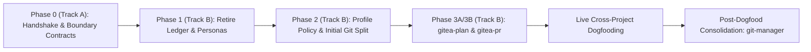
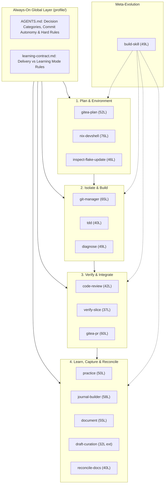

# Skills Ecosystem Redesign: Historical Engineering Retrospective

> [!IMPORTANT]
> **Historical Record:** This document records the point-in-time rationale, verification campaigns, failed intermediate assumptions, and empirical dogfood evidence behind the `80127b6` skills ecosystem redesign. It explains *why* the architecture took this shape; the live files under [`skills/`](../skills/), [`extensions/`](../extensions/), [`profile/AGENTS.md`](../profile/AGENTS.md), and [`profile/learning-contract.md`](../profile/learning-contract.md) remain the operational source of truth.

---

## 1. Starting Point & Structural Bottlenecks

Real-world engineering work across two multi-component repositories (a privilege-separated control-plane refactor spanning 57 files and `+10,130 / -1,118` lines, and a multi-service media pipeline) exposed six workflow bottlenecks in the earlier skills setup:

1. **Unhelpful Commit History vs. Ceremony Friction**: Commits either accumulated without clear slice boundaries, or mandatory per-commit human approval caused agents to hoard multi-issue edits in dirty working trees to avoid interrupting execution.
2. **Unread Administrative State (`commit-logger`)**: A CSV commit ledger accumulated metadata that was rarely consulted while coupling `git-commit`, `journal-builder`, and `draft-curation` to custom ledger maintenance.
3. **Unused Persona Coupling**: Agent persona files (`anne-droid.md` and `--as <persona>` isolation flags) increased installation and profile surface area without improving engineering outcomes.
4. **Blurred Quality-Gate Boundaries**: Static diff inspection (`code-review`), runtime behavioral verification (`verify-slice`), Git mechanics, and release decisions overlapped, producing either redundant diff re-audits or unverified cross-slice assumptions.
5. **Disconnected Planning & Execution**: Architectural plans lived in chat transcripts or vault drafts without proportional mapping to Gitea milestones, issues, and pull requests.
6. **Unscaled Ceremony**: Small fixes risked inheriting epic-level process overhead, whereas high-assurance changes (privilege boundaries, systemd sandboxing, concurrent state) needed structured multi-axis adversarial review.

**Governing Hypothesis:** A small collection of single-purpose skills (`<= 80` lines each), governed by an always-loaded global authority profile ([`profile/AGENTS.md`](../profile/AGENTS.md)) and coordinated through Gitea (`tea` CLI), makes engineering work predictable, traceable, and reversible while keeping human judgment focused on architecture, risk trade-offs, and merge authorization.

---

## 2. Chronological Evolution (17 Redesign Commits)

Building on the seam-based [`tdd`](../skills/tdd/SKILL.md) baseline (`f43146b`), the redesign executed across **17 commits (`09911e8..80127b6`)** in two tracks: **Track A** (preserving empirically validated QA contracts) and **Track B** (pruning legacy coupling, introducing Gitea coordination, and consolidating Git hygiene), followed by live cross-project dogfooding that corrected an intermediate split.

| Stage | Tracking | Commits (Count) | Architectural Outcome |
| :--- | :--- | :--- | :--- |
| **Phase 0 (Track A)** | Issue #1 *(Closed)* | `09911e8`, `2a3cf40` (2) | Hardened [`code-review`](../skills/code-review/SKILL.md) (exact base/head SHAs, staged/unstaged/untracked diff fingerprinting, repo-relative fenced Step 6 checks) and [`verify-slice`](../skills/verify-slice/SKILL.md) (handshake reuse invariant, 5-row disposition matrix, explicit `live-infra` owner authorization, static vs. runtime evidence split). |
| **Phase 1 (Track B)** | Issue #2 *(Closed)* | `bb8e145` (1) | Archived `commit-logger` and `anne-droid.md` under [`archive/`](../archive/README.md); added `OBSOLETE_SKILLS` / `OBSOLETE_AGENTS` detection and timestamped backup migration in [`install.sh`](../install.sh); updated [`journal-builder`](../skills/journal-builder/SKILL.md) and [`draft-curation`](../extensions/draft-curation/SKILL.md) to read directly from `git log`. |
| **Phase 2 (Track B)** | Issue #3 *(Closed)* | `9e94be0`, `a1cf7d3`, `501ec5c`, `8a85365`, `c17087a` (5) | Codified centralized decision categorization in [`profile/AGENTS.md`](../profile/AGENTS.md). Initially split Git into `git-commit` (checkpoint slicing) and `git-workspace` (branches, worktrees, rebase, reflog recovery) under the assumption that every commit required human approval. |
| **Phase 3A (Track B)** | Issue #4 *(Part 1)* | `a62aa58`, `83d08ef` (2) | Authored [`gitea-plan`](../skills/gitea-plan/SKILL.md) with Small / Medium / Large complexity scaling, rolling two-horizon decomposition, and verified `tea` CLI syntax in [`tea-cli.md`](../skills/gitea-plan/references/tea-cli.md). |
| **Phase 3B (Track B)** | Issue #4 *(Closed)* & Milestone Closed | `b0f7bdc`, `8ae79d9` (2) | Authored [`gitea-pr`](../skills/gitea-pr/SKILL.md) with pre-flight readiness checks, structured synthesis of `code-review` + `verify-slice` packets + `Closes #<id>`, inline review triage, and strict human merge authority. |
| **Post-Dogfood Consolidation** | Issue #3 *(Reconciled)* | `58c2b68`, `383fcf3`, `7ee3121`, `e99589b`, `80127b6` (5) | Resolved the Phase 2 split drift exposed by dogfooding: archived `git-commit` to [`archive/skills/git-commit/`](../archive/skills/git-commit/SKILL.md), unified all Git craft into [`git-manager`](../skills/git-manager/SKILL.md) + 4 reference guides, and enabled incremental working-branch commits without mid-work approval prompts in `delivery` mode. |

---

## 3. Empirical Test & Verification Campaigns

Four verification waves tested static contracts, CLI behavior, cross-repository workflows, and installation migrations:

### 3.1 Phase 0 Clean-Room Contract Matrix (`attendee-checkin` Fixture)
Seven session-local clean-room subagent runs exercised every state transition between `code-review` and `verify-slice`:
- **Static Defect & Clean-State Provenance (2 runs)**: Identified non-atomic lock/persistence races (`CR-01`), hostless URL validation bypasses `http://:80` and `https://@` (`CR-02`), and `-e` vs. `-S` Unix socket readiness bugs (`CR-03`) on the seeded fixture; issued `Status: Ready` with SHA256 diff fingerprints once fixed.
- **Case A: Valid `Ready` Handshake**: Verified matching base/head SHAs and clean working-tree state; bypassed redundant static diff re-inspection; executed `local` checks `RV-01..RV-03` (`PASS`, including 8-worker concurrency contention yielding `1x exit 0, 7x exit 49`) and recorded the unauthorized production socket check `RV-04` as `BLOCKED (out-of-bounds)`.
- **Case B1: Non-`Ready` Review Refusal**: Refused handshake bypass when the preceding review status was `Needs Rework`, ran full diff inspection, and reproduced `FAIL` on hostless URLs.
- **Case B2: Stale Working-Tree Invalidation**: Detected working-tree modifications relative to the reviewed `Ready` fingerprint and invalidated the handshake automatically.
- **Case C: Standalone `verify-slice`**: Operated without any prior `code-review` report, executing both Step 4 static diff inspection and Step 3 runtime assertions.
- **Case D: Authorized `live-infra` Check**: Given explicit owner authorization for an isolated staging Unix socket fixture, executed `RV-04` (`PASS`) while keeping the production socket untouched, followed by planned teardown of the test socket listener.

### 3.2 Gitea CLI (`tea`) Tooling Verification
Live verification against Gitea surfaced three concrete CLI constraints:
1. **`tea comment create` failure**: Fails with `strconv.ParseInt: parsing "create": invalid syntax`. Verified positional syntax (`tea comment <index> "<body>"` / `tea comments add <index> "<body>"`) is codified in [`tea-cli.md`](../skills/gitea-plan/references/tea-cli.md) and [`tea-pulls.md`](../skills/gitea-pr/references/tea-pulls.md).
2. **`tea issues list` milestone flag**: `tea issues create` accepts `--milestone`, whereas `tea issues list` requires `--milestones` / `-m`.
3. **`tea issues <idx>` SDK version-check bug**: Observed a `go-version` nil-pointer `SIGSEGV` in `tea` v0.16.0's `issueBackwardsCompatibility` path on single-issue detail lookup, whereas `tea issues list`, `tea comments list <idx>`, `tea comments add <idx>`, `tea issues close <idx>`, and `tea pulls` subcommands operated reliably.

### 3.3 Cross-Project Dogfooding & the Phase 2 Course Correction
Running the new ecosystem across two active production repositories provided an immediate A/B test of commit gating:
- **Control-Plane Security Remediation (`homelab-core`)**: Operated in an isolated worktree (`.worktrees/slice-1-security`), authored **17 red-to-green public-seam tests**, committed 4 atomic slices incrementally as each check passed, verified **337 passing unit/integration tests** (`0` Ruff/Pyright errors, Nix flake evaluation clean, `RV-01..RV-05` all `PASS`), opened a synthesized Gitea PR (`Closes #17, #18, #21`), and stopped cleanly for human merge review.
- **Workspace & Protobuf Contracts (`MagNetFlix`)**: Verified contract generation and workspace imports via public seam tests (`7/7` pytest checks in `0.22s`, `0` Ruff/Pyright errors under `nix develop`). However, because `git-commit` mandated human approval on every commit, the agent avoided interrupting mid-flow by **accumulating 12 modified/untracked paths across three separate issues (`#1..#3`) into a single uncommitted working tree** before proposing a 3-commit batch.

**Why This Forced Consolidation:** In Phase 2, keeping `git-commit` separate from `git-workspace` rested on the assumption that every commit needed an interactive human checkpoint. Once Gitea PR review + `code-review` + `verify-slice` became the exit gate before `main`, pausing on every local working-branch commit duplicated gating at the lowest-risk step and actively discouraged incremental commits. Archiving `git-commit`, unifying Git operations into `git-manager`, and moving working-branch commit autonomy into the always-loaded [`profile/AGENTS.md`](../profile/AGENTS.md) eliminated the bottleneck.

### 3.4 `git-manager` Migration & Repository Invariant Gate (`RV-01..RV-04`)
- **`RV-01` (Sandbox Symlink Migration)**: `PASS` - Broken `git-commit` and `git-workspace` symlinks flagged as `[OBSOLETE PRESENT]`, backed up to `skills.backup-<timestamp>/`, and replaced with `git-manager`.
- **`RV-02` (Sandbox Copy Mode & Provenance)**: `PASS` - Legacy copied directories backed up; `SKILL.md`, all 4 `references/*.md` files, and `.managed-by-skills-repo` (`HEAD` SHA) written cleanly.
- **`RV-03` (3-Way Parity & Hygiene Gate)**: `PASS` - Exact 14-skill parity across `skills/*/SKILL.md`, `install.sh`, and `README.md`; exact line counts verified `<= 80`; zero active `git-commit`/`git-workspace` references; zero em/en-dashes or hardcoded user home paths in added lines.
- **`RV-04` (Workstation `~/.gemini/config` Check)**: `PASS` - Live symlink installation migrated cleanly and passed `./install.sh check`.

---

## 4. Independent Subagent & Adversarial Review Findings

Isolated review passes (`code-review` across its four axes) caught real defects that implementing agents missed, while explicitly rejecting false positives:

| Review Pass | Target Scope | Independent Findings Caught | False Positives Explicitly Rejected |
| :--- | :--- | :--- | :--- |
| **Phase 0 Architectural Review** | `code-review` & `verify-slice` | **3 Must-Fix Contract Gaps**: (1) Reviewer workstation paths embedded in Step 6 commands risking testing a different checkout; (2) `git diff HEAD` omitting untracked file contents from handshake fingerprints; (3) static vs. runtime overlap in `Commit & Evidence Hygiene`. | Preserved the two-skill architecture (`code-review` = static provenance; `verify-slice` = runtime evidence). |
| **Phase 2 Independent Subagent** | `git-workspace` & `profile/AGENTS.md` | **`CR-01` & `CR-02`**: Caught omission of `git-workspace` from the `README.md` Interaction Matrix and caught line-count drift (`52` claimed vs. `50` actual, plus pre-existing drifts on `document`, `reconcile-docs`, and `nix-devshell`). | Accepted history-editing reference relocation commit boundary (`CR-03`) as benign. |
| **Phase 3B Independent Subagent** | `gitea-pr` | Verified all 4 axes (`Status: Ready`, `0` confirmed defects); validated quoted `<<'EOF'` heredocs against shell interpolation and verified flag parity against `tea` 0.16.0. | None required. |
| **Cross-Project 4-Axis Adversarial Pipeline** | Control-plane refactor (57 files) | **18 Confirmed Findings (8 Gitea Issues)**: Including **Critical** Compose AST long-syntax bind-mount containment bypass (`CR-DI-01`), `${VAR}` host-path escape (`CR-DI-02`), YAML secret exposure in `workload.config` (`CR-DI-03`), systemd clean-boot mount failure (`CR-SO-05`), and **tautological unit tests** mocking `subprocess.run` while production executed `subprocess.Popen` (`CR-TI-06`). | Consolidated overlapping multi-agent observations into 8 non-duplicative issues. |
| **`git-manager` Independent Subagent** | `refactor/git-manager` (`58c2b68..e99589b`) | **`CR-01` (Medium)**: Spotted `non-trivial cherry-picks` in `git-manager/SKILL.md` narrowing `profile/AGENTS.md`'s unconditional `cherry-pick` / `revert` pause. **`CR-02` (Low)**: Spotted `inspect-flake-update` Step 4 pre-drafting commit messages even in `learning` mode. **Seam Catch**: Noted `install.sh check` exits `0` even when `missing > 0`, asserting stdout directly in Step 6 checks. *(Both `CR-01` and `CR-02` resolved in `80127b6`.)* | **`CR-03`**: Preserved `git-commit` mentions in [`0001-session-mode-and-learning-contract.md`](./decisions/0001-session-mode-and-learning-contract.md) as an immutable historical ADR. **`CR-04` & `CR-05`**: Confirmed `git-manager` cohesion and `profile/AGENTS.md` pointer portability. |

---

## 5. Resulting System Composition Across the SDLC (At `80127b6`)

A critical design constraint in agent harnesses is **loading visibility**: [`profile/AGENTS.md`](../profile/AGENTS.md) is always loaded in system context on every turn, whereas individual `SKILL.md` bodies load on demand from their YAML `description`. Consequently, **commit autonomy and exception boundaries live in `profile/AGENTS.md`**, while **detailed procedures and conventions live in `skills/`**.

### SDLC Responsibility & Authority Matrix

#### Layer 0: Always-On Global Governance (`profile/`)
| Component | Role in SDLC | Core Invariant |
| :--- | :--- | :--- |
| **[`profile/AGENTS.md`](../profile/AGENTS.md)** | Global authority & human-in-the-loop contract | Explain first; architectural decisions framed 1-at-a-time; routine batches structured transparently; branch before edits; **autonomous incremental commits on non-default working branches in `delivery` mode**; mandatory stops on `main`/`master` (preventing zero-gate commits in solo repos), `learning` mode, conflicts/reverts/cherry-picks, anomalies, and destructive Git. |
| **[`profile/learning-contract.md`](../profile/learning-contract.md)** | Pedagogical mode contract (`learning` vs. `delivery`) | In `learning` mode, the human writes core reasoning and commit messages with calibrated rubric feedback (`correct`, `missing`, `wrong`, `unsupported` + assistance level); passing tests or commits are evidence, never automatic claims of mastery. |

#### Stage 1: Planning, Architecture & Development Environment
| Skill | Role in SDLC (Owns) | Hard Boundary (Refuses to Own) | Human Checkpoint ("Your call") |
| :--- | :--- | :--- | :--- |
| **[`gitea-plan`](../skills/gitea-plan/SKILL.md)** | Translates goals and plans into Gitea milestones, issues, and rolling horizons scaled by tier (`Small`, `Medium`, `Large`). | Git branches (`git-manager`); PR lifecycle (`gitea-pr`); replacing repo docs as technical truth. | Tier selection, issue slice boundaries, and batch issue creation approval. |
| **[`nix-devshell`](../skills/nix-devshell/SKILL.md)** | Authors, extends, validates (4 progressive levels), and troubleshoots `flake.nix` devShells or `shell.nix` from repo evidence. | Host NixOS/Home Manager config; mutating Git index/history; `flake.lock` bumps (`inspect-flake-update`). | Flake vs. `shell.nix`, adding inputs/systems, `allowUnfree`, and unverified version-sensitive mechanisms. |
| **[`inspect-flake-update`](../skills/inspect-flake-update/SKILL.md)** | Audits uncommitted `flake.lock` diffs input-by-input, surfaces upstream changelogs/CVEs, and runs `nix flake check`. | General Git history (`git-manager`); non-lockfile build debugging (`diagnose`). | Accepting/rolling back each input update, optional dry builds, and `main`/`learning` commit sign-off. |

#### Stage 2: Workspace Isolation, Implementation & Troubleshooting
| Skill | Role in SDLC (Owns) | Hard Boundary (Refuses to Own) | Human Checkpoint ("Your call") |
| :--- | :--- | :--- | :--- |
| **[`git-manager`](../skills/git-manager/SKILL.md)** | End-to-end local Git hygiene: branch-before-edits, isolated worktrees, incremental Conventional Commits (`delivery` vs. `learning`), rebase/squash/merge/cherry-pick, conflict halts, and evidence-first `reflog`/`fsck` recovery into `recovery/<topic>`. | Static code review (`code-review`); Gitea PR management (`gitea-pr`). | Commits on `main`/`master` or unfamiliar dirty trees, `learning`-mode messages, rebase vs. merge trade-offs, conflicts/reverts/cherry-picks, and destructive Git. |
| **[`tdd`](../skills/tdd/SKILL.md)** | Drives red-green vertical slices through public interface seams using boundary-only mocking, independent expected literals, and negative/conflict cases. | Trivial two-line/config edits; pre-merge diff review (`code-review`); live multi-service QA (`verify-slice`). | Approving new public interface seams, mock vs. real fixture boundaries, and edge-case coverage depth. |
| **[`diagnose`](../skills/diagnose/SKILL.md)** | Evidence-first root-cause investigation: raw symptoms -> falsifiable hypotheses -> stated-purpose probes -> proven cause -> minimal reversible fix -> probe cleanup. | Socratic self-discovery (`practice` when the user wants to solve it solo). | Ambiguous hypothesis selection, risky state transitions (push, deploy, data mutation), and whether to document the lesson. |

#### Stage 3: Static Audit, Runtime Verification & Pull Request Integration
| Skill | Role in SDLC (Owns) | Hard Boundary (Refuses to Own) | Human Checkpoint ("Your call") |
| :--- | :--- | :--- | :--- |
| **[`code-review`](../skills/code-review/SKILL.md)** | Audits diffs across 4 independent axes (`Spec & Scope`, `Standards & Smells`, `Seam & Test Integrity`, `Defensive Invariants`), pins exact revision/tree SHA256 provenance, preserves disagreements, and emits repo-relative fenced Step 6 runtime checks. | Executing live runtime QA (`verify-slice`); Git mutations (`git-manager`); authorizing release. | Rework vs. follow-up issue triage, adjudicating unresolved reviewer disagreements, and release sign-off. |
| **[`verify-slice`](../skills/verify-slice/SKILL.md)** | Executes risk-proportional falsifiable runtime checks (`PASS`, `FAIL`, `BLOCKED (env/fixture)`, `BLOCKED (out-of-bounds)`, `INCONCLUSIVE`); reuses static provenance *only* when a `Ready` review matches exact revisions and working-tree state; reconciles runtime evidence against test claims. | Root-cause debugging (`diagnose`); unauthorized `live-infra` execution; authorizing release. | Authorizing `live-infra` checks or costly setups, handling non-passing checks, and final release decision. |
| **[`gitea-pr`](../skills/gitea-pr/SKILL.md)** | Coordinates Gitea pull requests: pre-flight branch readiness, PR body synthesis (`Closes #<id>` + `code-review` provenance + `verify-slice` ledger + residual risks), inline review triage via `tea`, and merge-readiness reporting. | Static diff auditing (`code-review`); runtime QA (`verify-slice`); local Git rebase/merge (`git-manager`); auto-merging. | PR title/body approval, review feedback triage, and **exclusive human merge/release authorization**. |

#### Stage 4: Deliberate Practice, Knowledge Capture & Documentation Reconciliation
| Skill | Role in SDLC (Owns) | Hard Boundary (Refuses to Own) | Human Checkpoint ("Your call") |
| :--- | :--- | :--- | :--- |
| **[`practice`](../skills/practice/SKILL.md)** | Socratic tutoring and spaced-interval retrieval practice (`revisit_after` recall-before-reveal, 4-step help ladder, rubric calibration, transfer challenges). | Urgent production incident triage (`diagnose`). | Overdue revisit vs. new topic, solving the transfer challenge, and saving a practice record. |
| **[`journal-builder`](../skills/journal-builder/SKILL.md)** | Two-phase daily synthesis from `git log` and session history: generates a factual skeleton with reasoning blanks for the user, then calibrates answers against evidence. | Writing reflections on the user's behalf. | Answering the reasoning prompts and deciding what enters the permanent journal. |
| **[`document`](../skills/document/SKILL.md)** | Captures non-obvious session outcomes into 6 epistemic types (`Discussion`, `ADR`, `Plan`, `Debug Record`, `Knowledge`, `Journal`) built around the user's core sentence. | Repo-wide canonical doc audits (`reconcile-docs`); inbox triage (`draft-curation`). | Epistemic type confirmation, stating the core insight sentence, and choosing destination. |
| **[`draft-curation`](../extensions/draft-curation/SKILL.md)** *(Extension)* | Triages, formats, validates, and relocates staged `00-inbox/` notes into canonical vault lifecycle directories (reconciling daily journals without duplication). | Authoring fresh notes from scratch (`document`). | Approving target path/frontmatter, splitting multi-concern drafts, and journal merge edits. |
| **[`reconcile-docs`](../skills/reconcile-docs/SKILL.md)** | Audits and reconciles past commit/ADR history, present code reality, and future plans into canonical repository docs (`README.md`, `ARCHITECTURE.md`, `docs/adr/`, `ROADMAP.md`). | Single-session vault capture (`document`). | Conflict resolution (supersede vs. drop stale claims), Reconciliation Report approval, and ADR selection. |

#### Meta-Layer & Archived Components
- **[`build-skill`](../skills/build-skill/SKILL.md)** *(Manual `/build-skill`)*: Governs creation and empirical refinement of skills; first checks whether a need belongs in `AGENTS.md`, a script, or a human guide before creating a skill (`<= 80` lines).
- **[`archive/`](../archive/README.md)**: Preserves retired components (`skills/git-commit`, `extensions/commit-logger`, `agents/anne-droid.md`) outside active installation and runtime dependencies.
